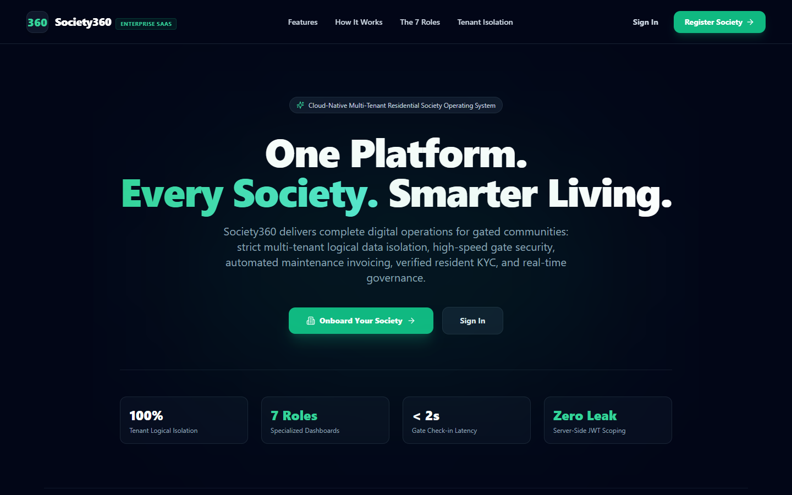
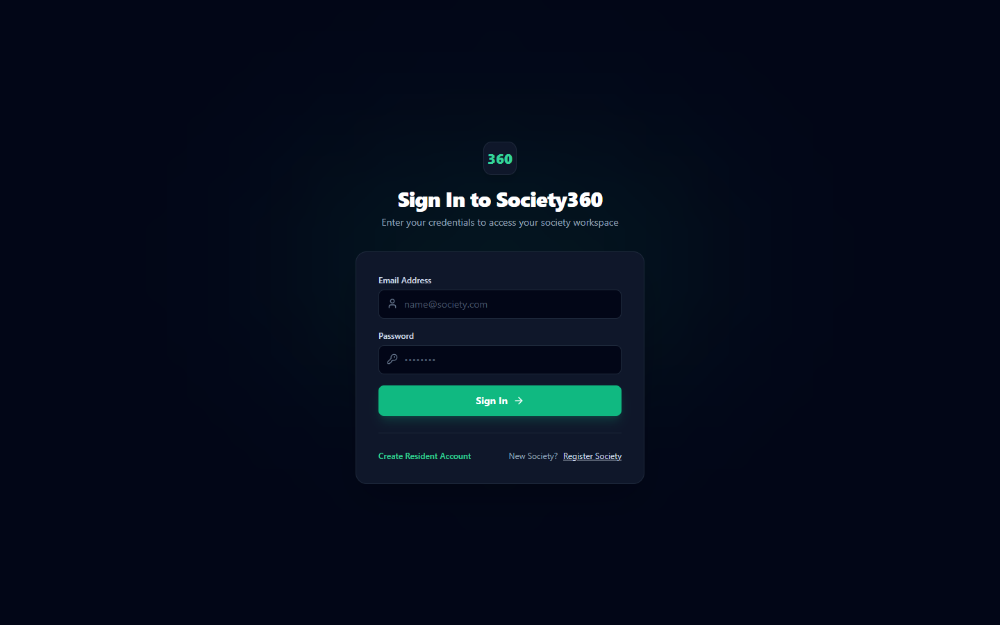
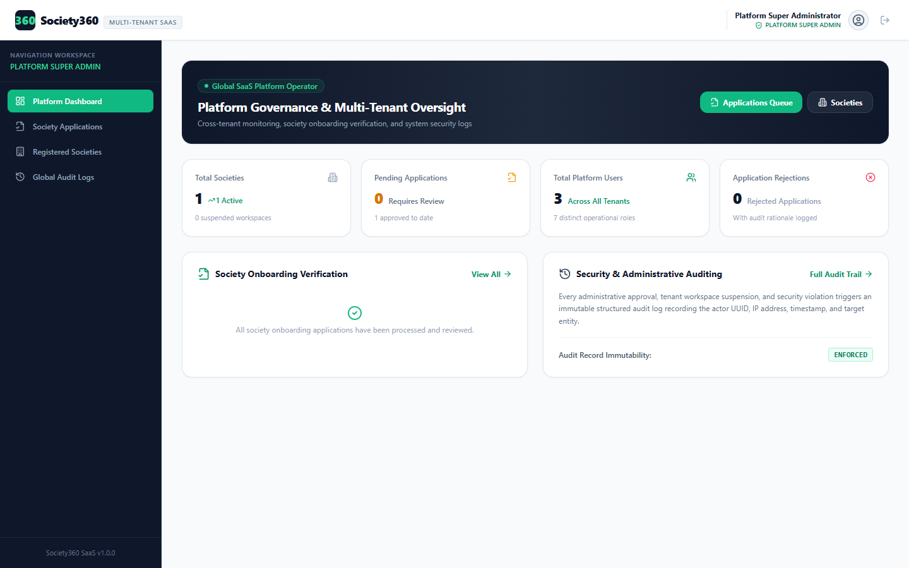
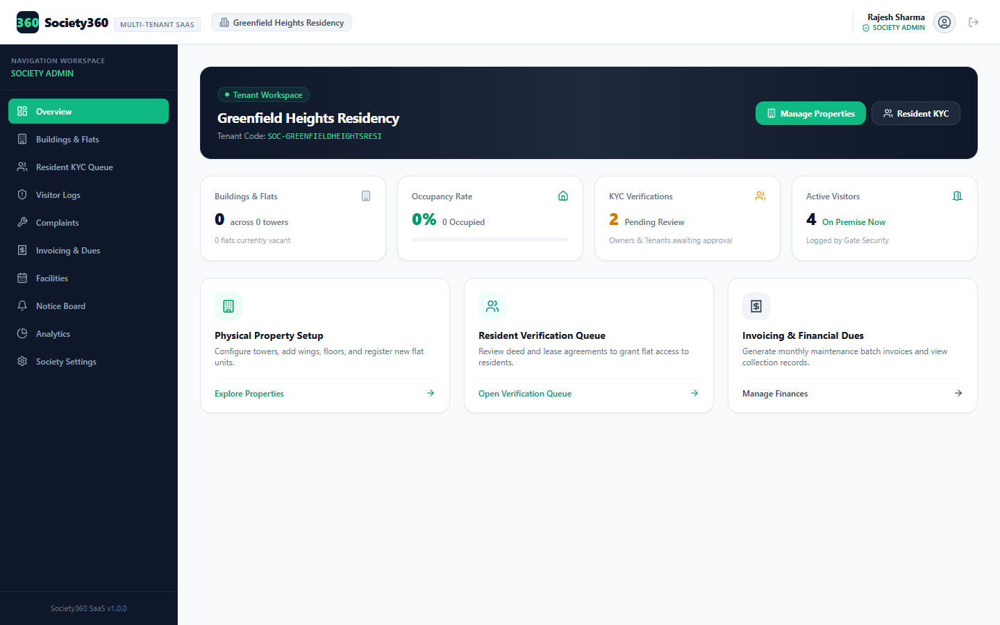
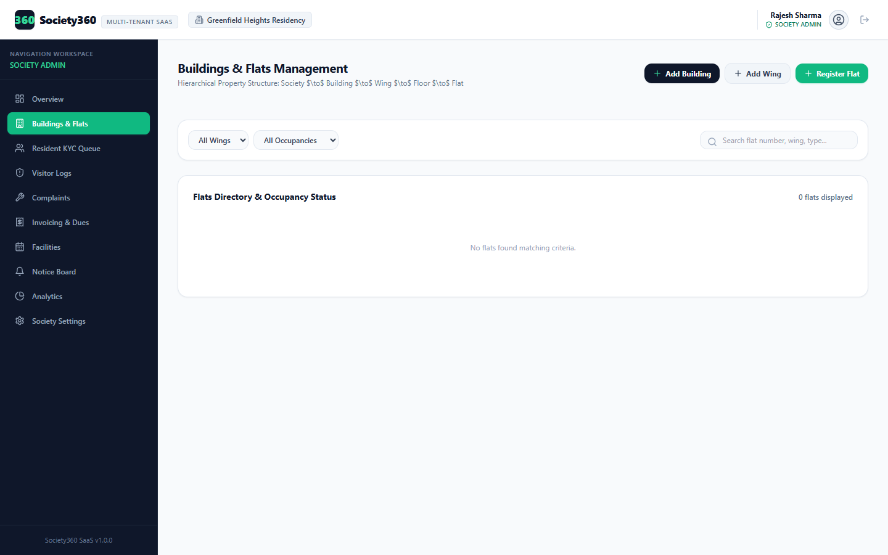
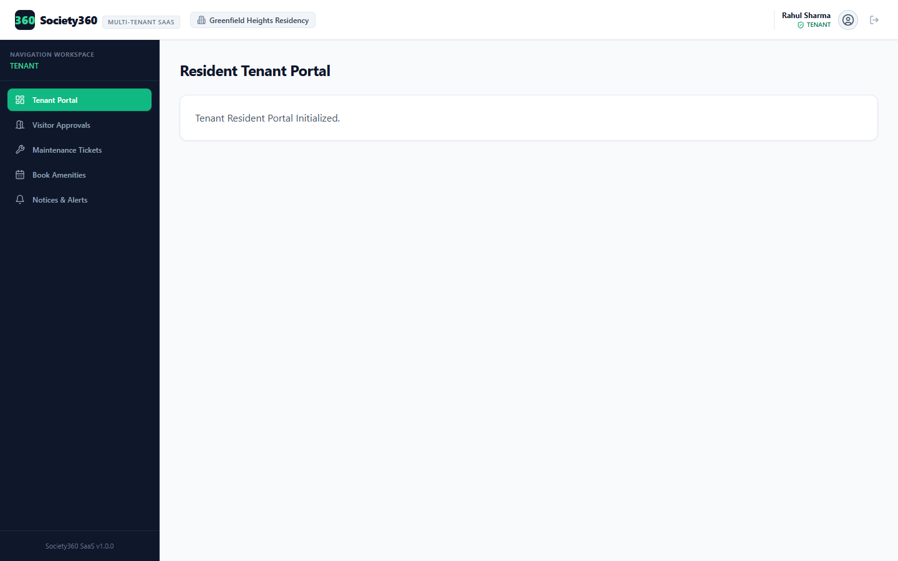
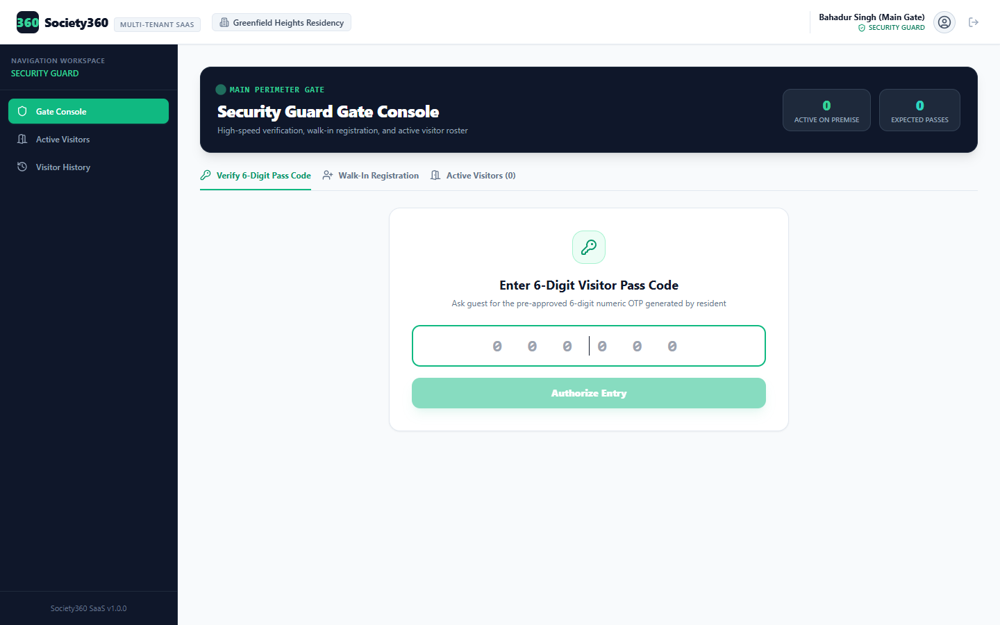

# Society360 — Multi-Tenant Residential Society Management Platform

<div align="center">

[](https://spring.io/projects/spring-boot)
[](https://www.oracle.com/java/)
[](https://react.dev/)
[](https://www.typescriptlang.org/)
[](https://tailwindcss.com/)
[](https://www.postgresql.org/)
[](https://www.docker.com/)
[-brightgreen.svg)]()
[](LICENSE)

<p align="center">
  <strong>"One Platform. Every Society. Smarter Living."</strong>
</p>

<p align="center">
  A production-style, multi-tenant Software-as-a-Service (SaaS) platform built to digitize, govern, and streamline residential housing society operations. Designed according to academic and enterprise software engineering principles derived from the research paper <em>"A Multi-Tenant Digital Platform for Residential Society Management"</em>.
</p>

</div>

---

## 📸 Live Application Showcase

<table align="center" width="100%">
  <tr>
    <td width="50%" align="center">
      
      <br/><b>🌐 Public SaaS Marketing Landing Page</b>
    </td>
    <td width="50%" align="center">
      
      <br/><b>🔐 Centralized Role-Based Sign In Portal</b>
    </td>
  </tr>
  <tr>
    <td width="50%" align="center">
      
      <br/><b>👑 Platform Super Admin Governance & Society Reviews</b>
    </td>
    <td width="50%" align="center">
      
      <br/><b>🏢 Society Administrator Operations Workspace</b>
    </td>
  </tr>
  <tr>
    <td width="50%" align="center">
      
      <br/><b>🏛️ 5-Tier Property Management (Buildings, Wings, Flats)</b>
    </td>
    <td width="50%" align="center">
      
      <br/><b>🏠 Resident Portal — Maintenance Bills & Dues</b>
    </td>
  </tr>
  <tr>
    <td colspan="2" align="center">
      
      <br/><b>🛡️ Security Guard Perimeter Gate Console (6-Digit OTP Verification & Active Roster)</b>
    </td>
  </tr>
</table>

---

## 1. Project Overview

### What is Society360?
**Society360** is an enterprise-grade web application engineered to manage multi-building housing complexes, gated communities, and residential societies. Instead of deploying separate websites for each housing society, Society360 hosts multiple independent societies on a single, shared infrastructure with strict logical data isolation between them.

> **What is Multi-Tenancy?**  
> Multi-tenancy is an architecture where multiple customer organizations (called "tenants" or societies) share the exact same software application and database, while strict digital barriers ensure that no society can ever view or touch another society's data.

### The Problem It Solves
Traditional residential society management is chaotic and fragmented:
- **Paper registers at security gates:** Lost visitor entries, long wait times, and illegible handwriting.
- **Messy WhatsApp groups:** Important maintenance notices get lost in everyday chatter, and arguments break out.
- **Manual maintenance collection:** Collecting checks, tracking unpaid dues in Excel spreadsheets, and handing out paper receipts.
- **Unresolved complaints:** Residents report water leaks or broken elevators, but nobody knows who is working on it or when it will be fixed.
- **Double-booked facilities:** Two residents show up to use the clubhouse or banquet hall at the exact same hour.

**Society360 replaces all of that with a clean, unified digital hub.**

---

### The 7 Tailored User Roles
Everyone in a residential community has different responsibilities. Society360 gives each person a tailored dashboard matching their exact role:

| # | Role Name | Primary Users | Key Responsibilities & Capabilities |
|:---:|---|---|---|
| **1** | `PLATFORM_SUPER_ADMIN` | Platform Owners & Operators | Reviews and approves new society registration requests, views system-wide statistics, and monitors security audit logs. |
| **2** | `SOCIETY_ADMIN` | Society President or Office Manager | Adds buildings and flats, verifies new resident accounts, creates maintenance invoices, and assigns complaints to staff. |
| **3** | `COMMITTEE_MEMBER` | Elected Board / Committee Members | Views financial reports, audits resident KYC applications, and posts official society-wide announcements. |
| **4** | `FLAT_OWNER` | Landlords & Homeowners | Views ownership records, pays monthly maintenance dues, generates 6-digit visitor passes, and books community amenities. |
| **5** | `TENANT` | Renters living in the flat | Pre-approves incoming guests/deliveries, submits maintenance complaints, views notice boards, and books amenities. |
| **6** | `SECURITY_GUARD` | Main Gate Security Staff | Verifies 6-digit guest pass codes, logs walk-in visitors/couriers, tracks active visitors, and logs checkout timestamps. |
| **7** | `MAINTENANCE_STAFF` | Electricians, Plumbers, Handymen | Views assigned repair tickets, updates job progress (`ASSIGNED` $\to$ `IN_PROGRESS` $\to$ `RESOLVED`), and logs resolution notes. |

---

## 2. Key Features & Innovations

1. **Strict Multi-Tenant Logical Isolation:**
   - Society tenancy is derived exclusively from cryptographically signed server-side JWT claims (`society_id`).
   - The platform enforces **Zero Trust in client-supplied tenant identifiers**: any client header or payload attempting to manipulate `society_id` is discarded.
   - Repository-level scoping ensures all database queries automatically filter by the authenticated user's `society_id`.

2. **Perimeter Security & 6-Digit Gate Pass Verification:**
   - Residents generate unique 6-digit numerical pass codes for guests, cabs, and couriers.
   - Security guards verify codes at the gate with instant feedback, reducing entrance wait times to seconds.
   - Real-time active visitor roster with stay duration tracking on checkout.

3. **Anti-Double-Booking Concurrency Engine:**
   - Amenities (Clubhouse, Banquet Hall, Sports Courts) utilize timestamp interval collision detection:
     $$\max(Start_A, Start_B) < \min(End_A, End_B)$$
   - Overlapping reservation attempts are automatically rejected with a clean `HTTP 409 Conflict` error.

4. **Payment Gateway Abstraction (Anti-Corruption Layer):**
   - Clean architectural interface (`PaymentGateway`) decoupling business logic from third-party payment processors.
   - Bundled with `SimulatedPaymentGateway` that generates verifiable bank transaction references (`TXN-...`) and instant cryptographic digital receipts.

5. **SLA-Driven Maintenance Dispatch:**
   - Residents submit tickets with categories, priority flags, and photo URLs.
   - Admins and Committee Members dispatch work orders directly to assigned maintenance staff.
   - Transparent progression states (`SUBMITTED` $\to$ `ASSIGNED` $\to$ `IN_PROGRESS` $\to$ `RESOLVED`) with mandatory technician resolution notes.

6. **Society Notice Bulletins & Emergency Alerts:**
   - Committee broadcast circulars with priority tags (`NORMAL`, `HIGH`, `URGENT`).
   - High-priority emergencies display a prominent alert banner on all resident dashboards.

---

## 3. Tech Stack (What & Why)

| Technology | Layer | What it is used for in Society360 | Why we chose it (in simple words) |
|---|---|---|---|
| **Java 21 (LTS)** | Backend | The core programming language powering the server. | Fast, type-safe, rock-solid, and supported by long-term industry standards. |
| **Spring Boot 3.3.3** | Backend | The primary backend framework handling web servers, controllers, and services. | Eliminates boilerplate setup, starts up quickly, and provides built-in enterprise features. |
| **Spring Security 6** | Backend | Protects every API endpoint, manages login sessions, and checks user roles. | Provides bank-grade security and blocks unauthorized requests before they touch our database. |
| **Spring Data JPA & Hibernate** | Backend | Talks to the database without writing raw SQL strings for every basic query. | Automatically translates Java classes into database tables (ORM) and speeds up development. |
| **JJWT (io.jsonwebtoken)** | Backend | Creates, signs, and decodes secure digital login badges (JSON Web Tokens). | Allows stateless login so the server does not need to store millions of sessions in memory. |
| **PostgreSQL 16** | Database | The main relational database for production data storage. | Highly reliable, supports ACID transactions, handles complex relationships, and scales gracefully. |
| **H2 In-Memory Database** | Database | Lightweight database that runs in RAM during local development. | Allows teammates to clone and run the backend immediately without installing PostgreSQL first. |
| **Springdoc OpenAPI (Swagger)** | Backend | Generates interactive API documentation at `/swagger-ui.html`. | Lets teammates view and test all 35+ backend REST API routes directly in their browser. |
| **React 18** | Frontend | The user interface library that builds dynamic web pages. | Allows modular, reusable component architecture with fast virtual-DOM updates. |
| **Vite 5** | Frontend | The build tool and local development server for the React app. | Extremely fast hot-reloading (updates your browser instantly when you save a file). |
| **TypeScript 5** | Frontend | Adds strict type checking to JavaScript code. | Catches spelling mistakes and bugs in code before running the browser, making teamwork seamless. |
| **Tailwind CSS 3.4** | Frontend | Utility-first CSS styling framework. | Enables rapid UI development and responsive design directly in component markup. |
| **Axios** | Frontend | HTTP client that sends network requests to the backend API. | Built-in request interceptors make it effortless to attach the user's JWT login token to every outgoing call. |
| **TanStack React Query** | Frontend | Manages fetching, caching, and auto-refreshing server data on the frontend. | Prevents duplicate network calls, provides loading states, and keeps dashboard data synchronized. |
| **React Hook Form + Zod** | Frontend | Form handling and input validation. | Ensures users cannot submit forms with missing fields or invalid email formats before sending data. |
| **Lucide React** | Frontend | Clean and modern SVG icon set. | Provides lightweight, consistent icons across navigation bars, cards, and action buttons. |
| **Recharts** | Frontend | Charting library for graphs and visual analytics. | Renders clean visual charts for society admin revenue, occupancy percentages, and complaint metrics. |
| **Docker & Docker Compose** | DevOps | Packages the database, backend, and frontend into portable containers. | Ensures the entire project runs identically on every computer with just one terminal command. |
| **Maven Wrapper (`mvnw`)** | Tooling | Java dependency and build management tool. | Bundles the exact right version of Maven so teammates don't need manual Maven installation. |

---

## 4. How Everything Connects (Architecture Walkthrough)

```mermaid
flowchart TD
    User["👤 Resident / Frontline User (React 18 UI)"] -->|1. HTTP Request with Bearer JWT| Axios["Frontend Axios Client (api.ts)"]
    Axios -->|2. POST /api/v1/...| SpringSec["Spring Security & JwtAuthenticationFilter"]
    SpringSec -->|3. Validate Token Signature| TenantFilter["TenantContextFilter"]
    TenantFilter -->|4. Store society_id safely| ThreadLocal["TenantContextHolder (ThreadLocal)"]
    ThreadLocal -->|5. Forward request| Controller["REST Controller"]
    Controller -->|6. Run business validation| Service["Domain Service Layer"]
    Service -->|7. Tenant-aware query| Repository["Spring Data JPA Repository"]
    Repository -->|8. SELECT/INSERT WHERE society_id = :id| Database[("Database (PostgreSQL 16 / H2)")]
    Database -->|9. Isolated records returned| Service
    Service -->|10. Formatted DTO response| Controller
    Controller -->|11. JSON Response (HTTP 200 OK)| User
```

### The 5 Simple Steps:
1. **Frontend Action:** A user clicks a button on the React page. The Axios client automatically takes the user's saved JWT login token and attaches it to the request header (`Authorization: Bearer <token>`).
2. **Security Check (Spring Security):** The backend receives the request. `JwtAuthenticationFilter` checks if the token is valid, has not expired, and has not been tampered with.
3. **Tenant Isolation (Multi-Tenancy Guard):** `TenantContextFilter` extracts the user's `society_id` from the secure token and stores it in `TenantContextHolder`.
   > **What is ThreadLocal?**  
   > `ThreadLocal` is a secure memory pocket in Java that keeps variables isolated to the specific thread handling that user's request, guaranteeing that one user's data can never accidentally mix into another user's request.
4. **Business Logic (Service Layer):** The controller passes the data to the service layer. The service performs checks—such as ensuring no other resident booked that exact facility at that exact time.
5. **Database Execution & Safe Return:** The repository executes the query, strictly including the `society_id`. The database returns the matching record, which flows back to the frontend as a clean JSON response.

---

## 5. Quick Start (Run Locally)

You can run Society360 on any computer using either **Option A (One-Command Docker Setup)** or **Option B (Manual Dev Setup with In-Memory H2)**.

### Prerequisites
Make sure you have installed on your computer:
- **Java 21 LTS** (`java -version`)
- **Node.js 18+ & npm** (`node -v` and `npm -v`)
- **Docker Desktop** (Optional, for running full containerized stack)

---

### Option A: Fastest One-Command Startup (Docker Compose)

Start the entire distributed platform (PostgreSQL 16 database + Spring Boot backend + React frontend) with a single command:

```bash
# 1. Clone the repository
git clone https://github.com/your-username/society360.git
cd society360

# 2. Start all services via Docker Compose
docker-compose -f docker/docker-compose.yml up --build
```

- **Frontend Web Application:** `http://localhost:3000`
- **Backend REST API:** `http://localhost:8080`
- **Interactive Swagger Docs:** `http://localhost:8080/swagger-ui.html`
- **PostgreSQL 16 Database:** `localhost:5432` (`society360_db` / `society360_user` / `society360_password`)

To stop all running containers:
```bash
docker-compose -f docker/docker-compose.yml down
```

---

### Option B: Manual Local Development (Zero-Config In-Memory H2)

This mode requires **no database setup**. The backend automatically boots an in-memory database with the default Super Admin account pre-configured.

#### 1. Setup Environment Variables
```bash
# Copy the template to .env
cp .env.example .env
```

#### 2. Start the Java Spring Boot Backend
Open a terminal in the project root:
```bash
cd backend

# On Windows PowerShell / Command Prompt:
.\mvnw.cmd spring-boot:run

# On Linux / macOS:
chmod +x ./mvnw
./mvnw spring-boot:run
```
- **Backend API Base:** `http://localhost:8080`
- **Interactive Swagger API Docs:** `http://localhost:8080/swagger-ui.html`
- **H2 Web Console:** `http://localhost:8080/h2-console`  
  *(JDBC URL: `jdbc:h2:mem:society360`, Username: `sa`, Password: leave blank)*

#### 3. Start the React Frontend
Open a **second** terminal window in the project root:
```bash
cd frontend

# Install node dependencies (first time only)
npm install

# Start Vite local development server
npm run dev
```
- **Web Application URL:** `http://localhost:3000`

---

### Default Platform Credentials

When the backend starts on a fresh database, it automatically provisions the initial **Platform Super Administrator**:

| Field | Default Value | Environment Override | Privileges |
|---|---|---|---|
| **Login URL** | `http://localhost:3000/login` | — | Sign in here |
| **Email** | `superadmin@society360.com` | `SUPERADMIN_EMAIL` | Global Platform Operator |
| **Password** | `Admin@12345` | `SUPERADMIN_PASSWORD` | Full cross-tenant governance |
| **Role** | `PLATFORM_SUPER_ADMIN` | — | Approve new societies, telemetry |

#### Complete Real-World Onboarding Workflow:
1. **Apply for a Society:** Go to `http://localhost:3000/register-society` and submit a society onboarding application.
2. **Super Admin Approval:** Sign in as Super Admin (`superadmin@society360.com` / `Admin@12345`), open **Society Applications**, and click **Approve**.
3. **Workspace Provisioned:** The society workspace is created, and the Society Admin can now log in to add wings, flats, and staff.
4. **Resident Sign Up & KYC:** Residents register at `http://localhost:3000/register` and submit their flat join request. Once verified by the admin or committee member, their flat dashboard is unlocked!

---

### Running Automated Test Suite

To verify tenant isolation and anti-double-booking concurrency control:

```bash
cd backend

# On Windows:
.\mvnw.cmd test

# On Linux / macOS:
./mvnw test
```

#### Verified Test Cases:
1. `testTenantContextLifecycle`: Validates `ThreadLocal` thread-safety, setting, retrieval, and guaranteed clean teardown without context contamination.
2. `testCrossTenantFlatIsolation`: Confirms that queries executed under Society A's scope strictly return Society A's records and **never leak any data belonging to Society B**.
3. `testAntiDoubleBookingOverlapDetection`: Proves that overlapping facility booking requests for the same time window trigger collision detection and throw `DoubleBookingException` (`HTTP 409 Conflict`).

---

## 6. Monorepo Directory Layout

```
BMS/
├── .env.example                   # Environment variables configuration template
├── README.md                      # Project documentation and showcase guide
├── docker/
│   └── docker-compose.yml         # Multi-container orchestration (PostgreSQL, Backend, Frontend)
│
├── database/
│   └── migrations/
│       └── V1__init_schema.sql    # 17 Relational tables, indexes, and foreign keys
│
├── backend/                       # Java 21 Spring Boot REST Application
│   ├── src/main/java/com/society360/
│   │   ├── config/                # SecurityConfig, CorsConfig, SuperAdminBootstrapDataLoader
│   │   ├── controller/            # 11 REST Controllers (Auth, Society, Property, Finance, etc.)
│   │   ├── domain/                # 17 JPA Entities (Society, UserAccount, Flat, Invoice, etc.)
│   │   ├── dto/                   # Request / Response Data Transfer Objects
│   │   ├── exception/             # Centralized GlobalExceptionHandler
│   │   ├── repository/            # Tenant-aware Spring Data JPA Repositories
│   │   ├── security/              # TenantContextHolder, TenantContextFilter, JwtTokenProvider
│   │   └── service/               # Domain Services & SimulatedPaymentGateway
│   ├── src/test/java/             # Automated Multi-Tenant Isolation & Concurrency Tests
│   ├── pom.xml                    # Maven dependencies (Spring Boot 3.3.3, Java 21)
│   ├── mvnw.cmd & mvnw            # Cross-platform Maven Wrappers
│   └── Dockerfile                 # Multi-stage Eclipse Temurin JRE container
│
├── frontend/                      # React 18 + TypeScript + Vite + Tailwind CSS SPA
│   ├── src/
│   │   ├── components/            # Reusable UI components (Navbar, Sidebar, MetricCard)
│   │   ├── context/               # AuthContext managing user login state & JWT tokens
│   │   ├── pages/                 # Full web screens grouped by user role
│   │   │   ├── public/            # LandingPage, SocietyRegistrationPage
│   │   │   ├── auth/              # LoginPage, RegisterPage
│   │   │   ├── superadmin/        # SuperAdminDashboard, SocietyApplications, AuditLogs
│   │   │   ├── admin/             # PropertyManagement, ResidentVerification, Finance, Analytics
│   │   │   ├── resident/          # Invoices, Pre-Approve Visitors, Complaints
│   │   │   ├── guard/             # Security Guard Gate Console
│   │   │   ├── staff/             # Maintenance Technician Work Order Board
│   │   │   ├── facilities/        # Amenity slot booking with anti-double-booking guard
│   │   │   └── notices/           # Society broadcast bulletin board
│   │   ├── routes/                # ProtectedRoute checking user role permissions
│   │   ├── services/api.ts        # Central Axios client targeting /api/v1/...
│   │   └── types/index.ts         # TypeScript interfaces for entities & DTOs
│   ├── package.json               # Dependencies & scripts
│   ├── vite.config.ts             # Vite development server configuration
│   └── Dockerfile & nginx.conf    # Production Nginx container configuration
│
└── docs/                          # Comprehensive technical blueprints and viva guides
    ├── USER_MANUAL.md             # Complete step-by-step end-user guide for 5 operational roles
    ├── 01_PRODUCT_REQUIREMENTS_DOCUMENT.md
    ├── 02_SYSTEM_ARCHITECTURE.md
    ├── 03_DATABASE_ERD_AND_SCHEMA.md
    ├── 04_ROLE_BASED_ACCESS_CONTROL_MATRIX.md
    ├── 05_API_DEVELOPMENT_PLAN.md
    ├── 06_IMPLEMENTATION_ROADMAP.md
    ├── SOCIETY360_MASTER_TECHNICAL_BLUEPRINT.md
    ├── VIVA_AND_EVALUATION_GUIDE.md
    └── screenshots/               # Application screenshot repository
```

---

## 7. Documentation & User Manuals

For in-depth operational guides and academic viva preparation, refer to the documents in [`docs/`](docs/):

| Document | Link | Summary |
|---|---|---|
| **📖 End-User Operations Manual** | [docs/USER_MANUAL.md](docs/USER_MANUAL.md) | **Step-by-step user manual** for Committee Members, Flat Owners, Tenants, Security Guards, and Maintenance Staff. |
| **🎓 Viva & Evaluation Guide** | [docs/VIVA_AND_EVALUATION_GUIDE.md](docs/VIVA_AND_EVALUATION_GUIDE.md) | 15 deep-dive viva questions & answers, live demo walkthrough script, and defense cheat-sheet. |
| **🏛️ Master Technical Blueprint** | [docs/SOCIETY360_MASTER_TECHNICAL_BLUEPRINT.md](docs/SOCIETY360_MASTER_TECHNICAL_BLUEPRINT.md) | Comprehensive engineering blueprint covering multi-tenancy, cybersecurity, and concurrency controls. |
| **📋 Product Requirements (PRD)** | [docs/01_PRODUCT_REQUIREMENTS_DOCUMENT.md](docs/01_PRODUCT_REQUIREMENTS_DOCUMENT.md) | Functional and non-functional product specifications and real-world requirements. |
| **🏗️ System Architecture** | [docs/02_SYSTEM_ARCHITECTURE.md](docs/02_SYSTEM_ARCHITECTURE.md) | Architectural tiers, security filters, and data flow diagrams. |
| **💾 Database ERD & Schema** | [docs/03_DATABASE_ERD_AND_SCHEMA.md](docs/03_DATABASE_ERD_AND_SCHEMA.md) | 17 relational database tables, foreign keys, indexes, and entity-relationship models. |
| **🔐 RBAC Permission Matrix** | [docs/04_ROLE_BASED_ACCESS_CONTROL_MATRIX.md](docs/04_ROLE_BASED_ACCESS_CONTROL_MATRIX.md) | Complete 7-role granular permission grid for all endpoints and modules. |
| **📡 REST API Development Plan** | [docs/05_API_DEVELOPMENT_PLAN.md](docs/05_API_DEVELOPMENT_PLAN.md) | 35+ REST API endpoint specifications with request payloads and response bodies. |
| **🗺️ Implementation Roadmap** | [docs/06_IMPLEMENTATION_ROADMAP.md](docs/06_IMPLEMENTATION_ROADMAP.md) | Development milestones, deliverables, and architecture phases. |

---

## 8. Team & Contributors

This project was developed by the engineering team below. Feel free to connect with us!

| Contributor | Role & Specialization | GitHub Profile |
|:---:|:---:|:---:|
| **Rohan Sonwane** | Full-Stack Architect & Backend Lead | [@ronnieee10x](https://github.com/ronnieee10x) |
| **Teammate 2** | Frontend Engineer & UI/UX Design | [@teammate2](https://github.com/teammate2) |
| **Teammate 3** | Database Architect & DevOps | [@teammate3](https://github.com/teammate3) |
| **Teammate 4** | QA Engineer & Cybersecurity | [@teammate4](https://github.com/teammate4) |

*(Update the table above with your teammates' actual names, roles, and GitHub handles).*

---

## 9. License & Acknowledgments

- **License:** This project is licensed under the [MIT License](LICENSE).
- **Academic Foundation:** Derived from the research paper *"A Multi-Tenant Digital Platform for Residential Society Management"*.
- **Technologies:** Built with Java 21, Spring Boot 3, React 18, Vite, TypeScript, Tailwind CSS, PostgreSQL 16, and Docker.

---

<p align="center">
  <strong>Society360 — One Platform. Every Society. Smarter Living.</strong>
</p>
