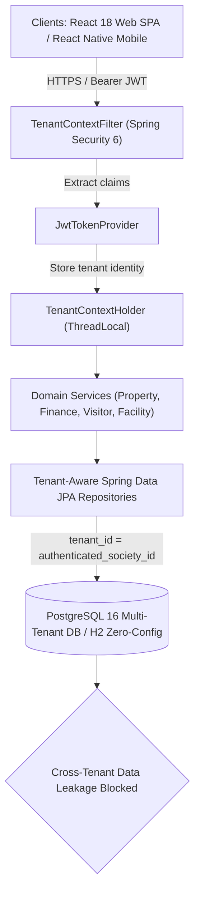

# Society360 — Multi-Tenant Residential Society Management Platform

[](https://spring.io/projects/spring-boot)
[](https://www.oracle.com/java/)
[](https://react.dev/)
[](https://www.typescriptlang.org/)
[](https://tailwindcss.com/)
[](https://www.postgresql.org/)
[](https://www.docker.com/)
[](LICENSE)

> *"One Platform. Every Society. Smarter Living."*

---

## Executive Overview

**Society360** is an enterprise-grade, multi-tenant Software-as-a-Service (SaaS) platform engineered to digitize, govern, and streamline residential housing society operations. Built strictly in accordance with academic and enterprise software engineering principles derived from the research paper *"A Multi-Tenant Digital Platform for Residential Society Management"*, Society360 replaces legacy fragmented setups (WhatsApp groups, physical registers, Excel spreadsheets, isolated desktop software) with a unified, cloud-native architecture.

The platform provides complete **logical multi-tenant isolation**, **7 distinct role-based access control (RBAC) tiers**, **SLA-driven maintenance ticket resolution**, **perimeter visitor gate pass authorization**, **anti-double-booking concurrency control**, **payment gateway abstraction**, and **real-time society business intelligence**.

---

## Key Architectural Highlights



1. **Strict Multi-Tenant Logical Isolation:**
   - Society tenancy is derived exclusively from cryptographically signed server-side JWT claims (`society_id`).
   - The platform enforces **Zero Trust in client-supplied tenant identifiers**: any client header or payload attempting to manipulate `society_id` is discarded.
   - Repository-level scoping ensures all database queries automatically filter by the authenticated user's `society_id`.
2. **7 Granular User Roles:**
   - `PLATFORM_SUPER_ADMIN`: Cross-society governance, society onboarding review, platform telemetry, audit logs.
   - `SOCIETY_ADMIN`: Society workspace operations, property hierarchy management, resident KYC verification, staff assignment.
   - `COMMITTEE_MEMBER`: Financial oversight, society-wide broadcast notices, governance reporting.
   - `FLAT_OWNER`: Asset ownership, tenant approvals, maintenance dues payment, digital voting, facility reservations.
   - `TENANT`: Flat occupancy, visitor pre-approvals, helpdesk ticketing, facility access.
   - `SECURITY_GUARD`: Physical perimeter gate operations, QR gate-pass verification, vehicle log, visitor entry/exit audit.
   - `MAINTENANCE_STAFF`: SLA-bound ticket queue, assignment workflow, status transitions (ASSIGNED → IN_PROGRESS → RESOLVED).
3. **Property Hierarchy Management:**
   - Strict 5-tier entity relational model: `Society` → `Building` → `Wing` → `Floor` → `Flat`.
   - Prevents duplicate flat numbering within identical wings/buildings.
4. **Perimeter Security & Anti-Duplication:**
   - Visitor gate-pass verification with real-time resident approval workflows.
   - In-memory/database anti-duplication constraints prevent re-entry of currently active visitors.
5. **Anti-Double-Booking Concurrency Engine:**
   - Amenities (Clubhouse, Banquet Hall, Sports Courts) utilize timestamp interval collision detection:
     $$\max(Start_A, Start_B) < \min(End_A, End_B)$$
   - Conflicting reservations are rejected with `DoubleBookingException` (`HTTP 409 Conflict`).
6. **Payment Gateway Abstraction (Anti-Corruption Layer):**
   - Clean architectural interface (`PaymentGateway`) decoupling business logic from third-party processors.
   - Bundled with `SimulatedPaymentGateway` that generates verifiable bank transaction references (`TXN-...`) and instant cryptographic digital receipts.

---

## Monorepo Directory Layout

```
society360/
├── backend/                       # Java 21 Spring Boot REST Application
│   ├── src/main/java/com/society360/
│   │   ├── config/                # SecurityConfig, CorsConfig, DemoSeedDataLoader
│   │   ├── controller/            # 10 REST Controllers (Auth, Society, Property, etc.)
│   │   ├── domain/                # 17 JPA Entities (Society, UserAccount, Flat, Invoice, etc.)
│   │   ├── dto/                   # Request / Response DTOs
│   │   ├── exception/             # Centralized GlobalExceptionHandler
│   │   ├── repository/            # 16 Spring Data JPA Repositories
│   │   ├── security/              # TenantContextHolder, TenantContextFilter, JwtTokenProvider
│   │   └── service/               # Domain Service Interfaces & Implementations
│   ├── src/test/java/             # Automated Multi-Tenant Isolation & Concurrency Tests
│   ├── pom.xml                    # Maven build file (Spring Boot 3.3.3, Java 21)
│   └── Dockerfile                 # Multi-stage Eclipse Temurin JRE container
│
├── frontend/                      # React 18 + TypeScript + Vite + Tailwind SPA
│   ├── src/
│   │   ├── components/            # Layout, Navbar, Sidebar, ProtectedRoute, MetricCard
│   │   ├── context/               # AuthContext (JWT lifecycle, 1-click role switcher)
│   │   ├── pages/                 # 15 Complete Dashboards & Workspaces
│   │   │   ├── landing/           # SaaS Marketing Landing Page
│   │   │   ├── auth/              # LoginPage (with 1-click 7-role viva demo switcher)
│   │   │   ├── superadmin/        # SuperAdminDashboard, SocietyApplications, SocietiesList, AuditLogs
│   │   │   ├── admin/             # SocietyAdminDashboard, PropertyManagement, ResidentVerification, Finance, Analytics
│   │   │   ├── resident/          # ResidentDashboard, Visitors, Invoices, Facilities, Complaints, Notices
│   │   │   ├── security/          # SecurityGuardGatePage (Visitor check-in/out, QR pass scanner)
│   │   │   └── staff/             # StaffTasksPage (SLA-driven maintenance ticket manager)
│   │   └── services/              # Centralized Axios API Client with JWT & Tenant interceptors
│   ├── package.json               # Dependencies (TanStack Query, Lucide Icons, Recharts, Zod)
│   ├── vite.config.ts             # Dev proxy & bundle configuration
│   └── Dockerfile & nginx.conf    # Production Nginx container configuration
│
├── mobile/                        # React Native / Expo Blueprint
│   ├── src/
│   │   ├── screens/               # GatePass, GuardScanner, MaintenanceTask, DuesPayment
│   │   ├── services/api.ts        # Axios API client mirroring Web client
│   │   └── context/AuthContext.tsx# Mobile Auth Context
│   └── app.json & package.json    # Expo configuration
│
├── database/                      # Relational Database Migrations
│   └── migrations/
│       └── V1__init_schema.sql    # 17 Relational Tables, Indexes & Foreign Keys
│
├── docker/                        # Production Orchestration
│   └── docker-compose.yml         # Full-stack Compose (PostgreSQL 16, Backend, Frontend)
│
└── docs/                          # Architectural Blueprints & Viva Resources
    ├── 01_PRODUCT_REQUIREMENTS_DOCUMENT.md
    ├── 02_SYSTEM_ARCHITECTURE.md
    ├── 03_DATABASE_ERD_AND_SCHEMA.md
    ├── 04_ROLE_BASED_ACCESS_CONTROL_MATRIX.md
    ├── 05_API_DEVELOPMENT_PLAN.md
    ├── 06_IMPLEMENTATION_ROADMAP.md
    ├── SOCIETY360_MASTER_TECHNICAL_BLUEPRINT.md
    └── VIVA_AND_EVALUATION_GUIDE.md
```

---

## Initial Super Admin Bootstrap & Access

On fresh database initialization, the platform automatically provisions a single initial **Platform Super Administrator** account configured via environment variables or `application.yml`:

| Attribute | Default Value | Environment Variable Override | Privileges |
| :--- | :--- | :--- | :--- |
| **Email** | `superadmin@society360.com` | `SUPERADMIN_EMAIL` | Global Platform Operator |
| **Password** | `Admin@12345` | `SUPERADMIN_PASSWORD` | Full cross-tenant governance, approve new societies, platform analytics, audit trail |
| **Name** | `Platform Super Administrator` | `SUPERADMIN_NAME` | Root administrator identity |

### Real Production Onboarding Lifecycle
1. **Platform Super Admin Login:** Sign in using the Super Admin credentials above at `/login`.
2. **Society Onboarding:** Prospective housing societies apply via the public form at `/register-society`.
3. **Approval & Workspace Provisioning:** The Super Admin reviews documentation and approves the society, automatically generating its isolated workspace and activating the Society Admin account.
4. **Resident Sign-Up & KYC:** Residents create accounts at `/register` and submit flat join requests for administrative approval.

---

## Quickstart & Installation Guide

### Option A: Local Development (Fastest — Zero-Config H2 In-Memory)

The backend defaults to the `dev` profile, running an in-memory PostgreSQL-compatible H2 database with automatic schema creation and initial Super Admin bootstrap.

#### 1. Start the Java Spring Boot Backend
```bash
# Ensure Java 21 LTS is installed
cd backend
.\mvnw.cmd spring-boot:run
```
- API Base: `http://localhost:8080`
- Swagger / OpenAPI UI: `http://localhost:8080/swagger-ui.html`
- H2 Web Console: `http://localhost:8080/h2-console` (JDBC URL: `jdbc:h2:mem:society360`, User: `sa`, Password: *blank*)

#### 2. Start the React Frontend
```bash
cd frontend
npm install
npm run dev
```
- Web Application: `http://localhost:3000`

---

### Option B: Production Docker Deployment (PostgreSQL 16)

Run the entire distributed multi-tenant platform (Database + Spring Boot Backend + Nginx Frontend) in Docker containers with a single command:

```bash
# From the repository root
docker-compose -f docker/docker-compose.yml up --build -d
```
- Frontend Web App: `http://localhost:3000`
- Backend REST API: `http://localhost:8080`
- PostgreSQL 16 DB: `localhost:5432` (`society360_db` / `society360_user` / `society360_password`)

---

## Running Automated Security & Multi-Tenancy Tests

The test suite validates the core architectural invariant: **Strict Logical Data Isolation between Societies**.

```bash
cd backend
.\mvnw.cmd test
```

### Verified Test Cases:
1. `testTenantContextLifecycle`: Validates `TenantContextHolder` ThreadLocal thread safety, setting, retrieval, and guaranteed clean teardown without context contamination.
2. `testCrossTenantFlatIsolation`: Confirms that a query executed under Society A's tenant scope strictly returns Society A's flats and **never leaks or returns any record belonging to Society B**.
3. `testAntiDoubleBookingOverlapDetection`: Confirms that concurrent or overlapping facility booking requests for the same time window trigger collision detection and throw `DoubleBookingException` (`HTTP 409 Conflict`).

---

## REST API Specification Summary

The backend exposes 35+ production-grade REST endpoints documented via OpenAPI 3.0 / Swagger at `/swagger-ui.html`.

### 1. Authentication & Identity (`/api/auth`)
- `POST /api/auth/login`: Authenticate credentials, issue stateless JWT and refresh token.
- `POST /api/auth/register`: Public self-registration for residents.
- `GET /api/auth/me`: Retrieve authenticated user identity, role, and tenant context.

### 2. Society Onboarding & Super Admin (`/api/societies`, `/api/superadmin`)
- `POST /api/societies/register`: Public multi-step society onboarding application.
- `GET /api/superadmin/applications`: Fetch pending society registration requests.
- `POST /api/superadmin/applications/{id}/approve`: Approve society, mint unique society identifier (`SOC-...`), activate society admin workspace.
- `POST /api/superadmin/applications/{id}/reject`: Reject society with audited explanation.
- `GET /api/superadmin/analytics`: Platform-wide society count, user count, and onboarding telemetry.
- `GET /api/superadmin/audit-logs`: Cross-platform immutable security audit trail.

### 3. Property Hierarchy (`/api/properties`)
- `GET /api/properties/hierarchy`: Retrieve full recursive tree (`Building` → `Wing` → `Floor` → `Flat`).
- `POST /api/properties/buildings`: Create new building in society workspace.
- `POST /api/properties/wings`: Create wings attached to a building.
- `POST /api/properties/flats`: Register flats with area, type, and occupancy state.

### 4. Resident KYC & Verification (`/api/residents`)
- `GET /api/residents/pending-verifications`: List unverified resident onboarding requests.
- `POST /api/residents/verify/{id}`: Approve/Reject resident KYC and associate with flat occupancy.

### 5. Perimeter Security & Gate Management (`/api/visitors`)
- `POST /api/visitors/pre-approve`: Resident pre-approves incoming visitor pass.
- `POST /api/visitors/entry`: Security Guard logs visitor entry with anti-duplication verification.
- `POST /api/visitors/{id}/exit`: Security Guard records visitor checkout timestamp.
- `GET /api/visitors/active`: Real-time register of visitors currently on society premises.

### 6. SLA-Driven Maintenance & Complaints (`/api/complaints`)
- `POST /api/complaints`: Resident logs maintenance issue with priority and category.
- `GET /api/complaints`: Society Admin / Staff ticket queue.
- `PATCH /api/complaints/{id}/status`: Staff / Admin status progression (`OPEN` → `ASSIGNED` → `IN_PROGRESS` → `RESOLVED`).

### 7. Accounting & Dues Payment (`/api/finance`)
- `GET /api/finance/invoices`: List society maintenance invoices.
- `POST /api/finance/invoices/generate`: Admin bulk billing generation.
- `POST /api/finance/pay`: Resident checkout via `PaymentGateway` anti-corruption layer.

### 8. Amenities & Anti-Double-Booking (`/api/facilities`)
- `GET /api/facilities`: List society amenities (Pool, Clubhouse, Tennis Court, Banquet Hall).
- `POST /api/facilities/book`: Reserve amenity slot with timestamp overlap collision guard.

### 9. Analytics & Business Intelligence (`/api/analytics`)
- `GET /api/analytics/overview`: Real-time KPI telemetry (Occupancy rate, Dues collection %, Open complaints, Daily visitor count).

---

## Academic Viva & Technical Evaluation Presentation

Refer to our comprehensive [Viva and Evaluation Defense Guide](docs/VIVA_AND_EVALUATION_GUIDE.md) for:
- 15 Deep-Dive Viva Questions & Answers covering Multi-Tenancy vs Multi-Database, Concurrency Locks, ThreadLocal Memory Leaks, JWT Invalidation, and Spring Security Filter Chains.
- Step-by-Step 10-Minute Live Demo Walkthrough Script.
- Software Engineering & Architecture Comparison Tables.

---

## Authors & Acknowledgments

- **Platform Architect & Engineering Team:** Society360 Core Contributors
- **Theoretical Foundation:** *"A Multi-Tenant Digital Platform for Residential Society Management"*
- **Technologies:** Spring Boot, Spring Security, Hibernate, PostgreSQL, React, Vite, Tailwind CSS, TypeScript, Docker.

---
*Society360 — One Platform. Every Society. Smarter Living.*
