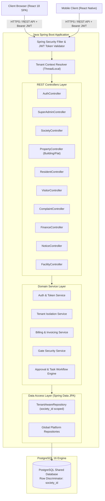
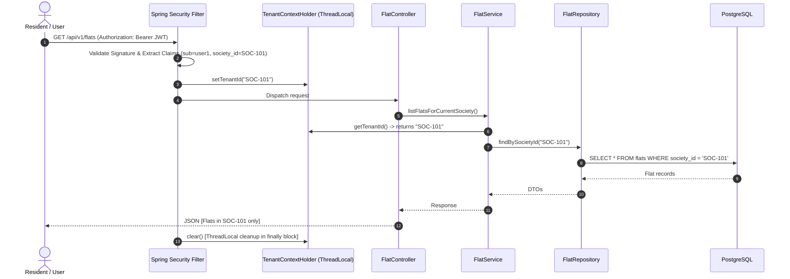

# Society360 — System Architecture Document

**Document Version:** 1.0.0  
**Target Stack:** React 18 (Vite + TypeScript + Tailwind CSS) + Java 21 Spring Boot 3.x + PostgreSQL 16  
**Pattern:** Clean Layered Architecture, Tenant Context Interceptor, RBAC Security Filter Chain  

---

## 1. High-Level Architecture Overview

Society360 follows an enterprise-grade multi-tenant architecture with logical tenant partitioning over a shared relational database. The solution is organized as a unified monorepo containing the web frontend, the backend RESTful microservice/monolith, mobile endpoints, database migration scripts, and Docker containerization recipes.



---

## 2. Multi-Tenant Architecture & Isolation Engine

### 2.1 Multi-Tenancy Strategy: Shared Database, Tenant Discriminator Column
In residential management platforms, operational overhead and maintenance costs make separate databases for every 100-flat apartment complex cost-prohibitive. Society360 utilizes a **Shared Database with Discriminator Column (`society_id`)** pattern, backed by strict server-side context validation.

### 2.2 Server-Side Tenant Resolution (Zero Trust in Frontend Input)
1. **Never trust `society_id` sent in HTTP request bodies or query parameters** for authorization or data filtering.
2. During login, the server authenticates user credentials, looks up their approved society membership, and embeds the verified `society_id` and role claims into the signed, encrypted JWT.
3. On every incoming request:
   - `JwtAuthenticationFilter` verifies the JWT signature and extracts the principal.
   - `TenantContextFilter` extracts the `society_id` claim from the validated principal and populates a thread-scoped `TenantContextHolder` (`ThreadLocal<UUID>`).
   - Every database query in domain repositories applies:
     $$\text{WHERE entity.society\_id = TenantContextHolder.getTenantId()}$$
4. **Platform Super Admin Exception:** When the authenticated principal holds the `PLATFORM_SUPER_ADMIN` role, the tenant filter is bypassed or explicitly set to target a specified society during administrative inspection.



---

## 3. Layered Backend Design

The backend enforces strict separation of concerns into four distinct layers:

```
src/main/java/com/society360/
├── config/             # Spring Security, CORS, OpenAPI Swagger, Jackson
├── security/           # JWT filters, UserDetails, TenantContext, PasswordEncoder
├── domain/             # Entities, Enums, Embeddables
│   ├── auth/           # UserAccount, Role, RefreshToken, PasswordResetToken
│   ├── society/        # Society, SocietyApplication, SocietySetting
│   ├── property/       # Building, Wing, Floor, Flat, Occupancy
│   ├── resident/       # ResidentProfile, ResidentDocument
│   ├── visitor/        # VisitorEntry, DeliveryEntry, VisitorPass
│   ├── maintenance/    # Complaint, MaintenanceTask, TaskEvidence
│   ├── finance/        # Invoice, Payment, PaymentReceipt
│   ├── notice/         # Notice, NoticeReadStatus, Poll
│   ├── facility/       # Facility, FacilityBooking
│   └── audit/          # AuditLog, PlatformMetric
├── dto/                # Request and Response transfer objects with validation
├── repository/         # Spring Data JPA repositories with tenant-scoped queries
├── service/            # Transactional business logic (@Transactional)
│   ├── impl/           # Concrete service implementations
│   └── payment/        # PaymentGateway interface & implementations
├── controller/         # REST Controllers (@RestController)
└── exception/          # GlobalExceptionHandler (@ControllerAdvice), Custom exceptions
```

### 3.1 DTO & Bean Validation Pattern
- Entities are never directly exposed to or accepted from the API.
- All request payloads use dedicated DTOs with Jakarta Bean Validation annotations (`@NotBlank`, `@Email`, `@Size`, `@Pattern`, `@Positive`).
- Centralized `GlobalExceptionHandler` converts validation failures into standard RFC-7807 problem details or unified API response structures (`ApiResponse<T>`).

---

## 4. Frontend Architecture (React 18 + Vite + Tailwind CSS)

```
frontend/
├── src/
│   ├── assets/         # Logos, branding assets, illustrations
│   ├── components/     # Reusable UI system
│   │   ├── common/     # Buttons, Modals, Badges, Loaders, EmptyStates
│   │   ├── forms/      # Input, Select, Textarea, FileUpload, DatePicker
│   │   ├── tables/     # Responsive data tables with pagination and search
│   │   ├── charts/     # Recharts wrappers for analytics
│   │   └── navigation/ # Navbar, Sidebar, Breadcrumbs, RoleSwitcher
│   ├── context/        # React Context providers (AuthContext, TenantContext, ThemeContext)
│   ├── hooks/          # Custom hooks (useAuth, useTenant, usePermissions, useDebounce)
│   ├── layouts/        # Distinct layout shells per role
│   │   ├── PublicLayout.tsx       # Landing page, public registration, login
│   │   ├── SuperAdminLayout.tsx   # SaaS oversight, global platform metrics
│   │   ├── SocietyAdminLayout.tsx # Comprehensive society administration
│   │   ├── CommitteeLayout.tsx    # Governance, financial audits, oversight
│   │   ├── ResidentLayout.tsx     # Owner and Tenant resident portal
│   │   ├── SecurityLayout.tsx     # High-speed gatekeeper guard console
│   │   └── StaffLayout.tsx        # Mobile-first maintenance tasks queue
│   ├── pages/          # Page components grouped by role and feature
│   ├── routes/         # React Router 6 configuration with ProtectedRoute
│   ├── services/       # Axios API clients with automatic token refresh
│   ├── types/          # TypeScript interfaces matching backend DTOs
│   └── utils/          # Formatting, date utilities, currency formatters
```

---

## 5. Security & Authentication Architecture

1. **Authentication:**
   - Stateless JWT tokens (HMAC-SHA256 / RSA).
   - Access token lifespan: 30 minutes.
   - DB-backed refresh token lifespan: 7 days with rotation.
   - Passwords hashed using Spring Security `BCryptPasswordEncoder(12)`.
2. **Authorization:**
   - Role-Based Access Control via `@PreAuthorize("hasRole('SOCIETY_ADMIN')")`.
   - Method-level security annotations on all business service methods.
3. **CORS & CSRF:**
   - Stateless REST APIs with CSRF disabled, CORS configured with strict allowed origins.
4. **Audit Logging:**
   - High-privilege mutations (application approvals, user role changes, financial adjustments) are written asynchronously to an immutable `audit_logs` table.
