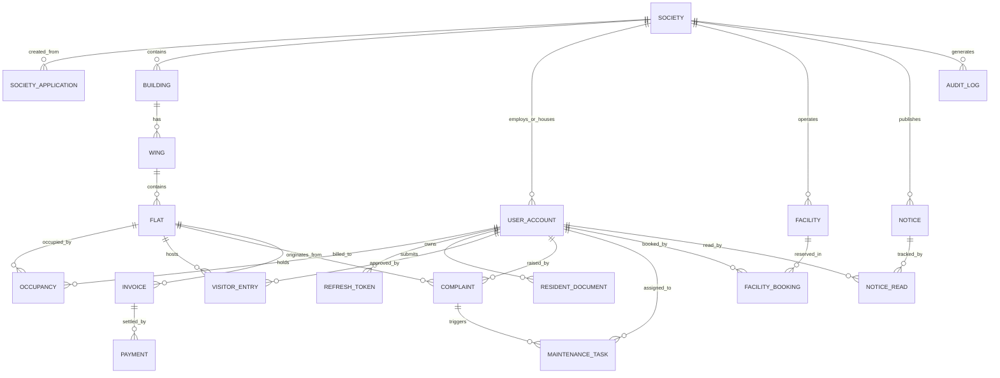

# Society360 — Database Entity-Relationship (ER) & Schema Specification

**Document Version:** 1.0.0  
**Database Engine:** PostgreSQL 16  
**Multi-Tenant Mechanism:** Shared Database with `society_id` Discriminator Indexing  
**Integrity Strategy:** Strict Foreign Keys, Unique Composite Constraints, Audit Timestamps  

---

## 1. High-Level Entity Relationship Diagram (ERD)

---

## 2. Comprehensive Relational Schema Specification

### 2.1 Core Platform & Tenancy Entities

#### `societies`
Represents an approved, operating residential housing society workspace.
- `id` (UUID, PRIMARY KEY)
- `code` (VARCHAR(30), UNIQUE, NOT NULL) — e.g., `SOC-GREENFIELD`
- `name` (VARCHAR(150), NOT NULL) — e.g., "Greenfield Heights Cooperative Housing Society"
- `registration_number` (VARCHAR(80), UNIQUE, NOT NULL)
- `address_line` (TEXT, NOT NULL)
- `city` (VARCHAR(80), NOT NULL)
- `state` (VARCHAR(80), NOT NULL)
- `pin_code` (VARCHAR(12), NOT NULL)
- `status` (VARCHAR(25), NOT NULL) — `ACTIVE`, `SUSPENDED`, `INACTIVE`
- `settings` (JSONB) — maintenance formula, visitor curfew hours, late payment fee %
- `created_at` (TIMESTAMPTZ, NOT NULL DEFAULT NOW())
- `updated_at` (TIMESTAMPTZ, NOT NULL DEFAULT NOW())

#### `society_applications`
Onboarding requests submitted by prospective society representatives for Super Admin evaluation.
- `id` (UUID, PRIMARY KEY)
- `society_name` (VARCHAR(150), NOT NULL)
- `registration_number` (VARCHAR(80), NOT NULL)
- `address_line` (TEXT, NOT NULL)
- `city` (VARCHAR(80), NOT NULL)
- `state` (VARCHAR(80), NOT NULL)
- `pin_code` (VARCHAR(12), NOT NULL)
- `building_count` (INT, NOT NULL)
- `flat_count` (INT, NOT NULL)
- `applicant_name` (VARCHAR(100), NOT NULL)
- `applicant_email` (VARCHAR(120), NOT NULL)
- `applicant_phone` (VARCHAR(20), NOT NULL)
- `document_url` (VARCHAR(255))
- `status` (VARCHAR(30), NOT NULL DEFAULT 'PENDING') — `PENDING`, `UNDER_REVIEW`, `APPROVED`, `REJECTED`, `ADDITIONAL_INFO_REQUIRED`
- `rejection_reason` (TEXT)
- `reviewed_by` (UUID REFERENCES user_accounts(id))
- `reviewed_at` (TIMESTAMPTZ)
- `created_at` (TIMESTAMPTZ, NOT NULL DEFAULT NOW())
- `updated_at` (TIMESTAMPTZ, NOT NULL DEFAULT NOW())

---

### 2.2 Identity & Access Management Entities

#### `user_accounts`
Stores all platform users across the 7 roles.
- `id` (UUID, PRIMARY KEY)
- `society_id` (UUID REFERENCES societies(id), NULL for PLATFORM_SUPER_ADMIN)
- `full_name` (VARCHAR(100), NOT NULL)
- `email` (VARCHAR(120), UNIQUE, NOT NULL)
- `phone` (VARCHAR(20), NOT NULL)
- `password_hash` (VARCHAR(255), NOT NULL)
- `role` (VARCHAR(35), NOT NULL) — `PLATFORM_SUPER_ADMIN`, `SOCIETY_ADMIN`, `COMMITTEE_MEMBER`, `FLAT_OWNER`, `TENANT`, `SECURITY_GUARD`, `MAINTENANCE_STAFF`
- `status` (VARCHAR(25), NOT NULL DEFAULT 'ACTIVE') — `PENDING_VERIFICATION`, `ACTIVE`, `SUSPENDED`, `DEACTIVATED`
- `avatar_url` (VARCHAR(255))
- `created_at` (TIMESTAMPTZ, NOT NULL DEFAULT NOW())
- `updated_at` (TIMESTAMPTZ, NOT NULL DEFAULT NOW())
- **Indexes:** `idx_users_society_id(society_id)`, `idx_users_email(email)`, `idx_users_role(role)`

#### `refresh_tokens`
Enforces secure, revocable token rotation.
- `id` (UUID, PRIMARY KEY)
- `user_id` (UUID REFERENCES user_accounts(id) ON DELETE CASCADE, NOT NULL)
- `token` (VARCHAR(255), UNIQUE, NOT NULL)
- `expires_at` (TIMESTAMPTZ, NOT NULL)
- `revoked` (BOOLEAN NOT NULL DEFAULT FALSE)
- `created_at` (TIMESTAMPTZ NOT NULL DEFAULT NOW())

---

### 2.3 Physical Property Hierarchy Entities

#### `buildings`
- `id` (UUID, PRIMARY KEY)
- `society_id` (UUID REFERENCES societies(id) ON DELETE CASCADE, NOT NULL)
- `name` (VARCHAR(80), NOT NULL) — e.g., "Tower A", "Pine Block"
- `total_floors` (INT NOT NULL DEFAULT 1)
- `description` (TEXT)
- `created_at` (TIMESTAMPTZ DEFAULT NOW())
- **Constraints:** UNIQUE (`society_id`, `name`)

#### `wings`
- `id` (UUID, PRIMARY KEY)
- `building_id` (UUID REFERENCES buildings(id) ON DELETE CASCADE, NOT NULL)
- `society_id` (UUID REFERENCES societies(id) ON DELETE CASCADE, NOT NULL)
- `name` (VARCHAR(30), NOT NULL) — e.g., "East Wing", "Wing 1"
- **Constraints:** UNIQUE (`building_id`, `name`)

#### `flats`
- `id` (UUID, PRIMARY KEY)
- `society_id` (UUID REFERENCES societies(id) ON DELETE CASCADE, NOT NULL)
- `building_id` (UUID REFERENCES buildings(id) ON DELETE CASCADE, NOT NULL)
- `wing_id` (UUID REFERENCES wings(id) ON DELETE CASCADE, NOT NULL)
- `flat_number` (VARCHAR(30), NOT NULL) — e.g., "101", "A-504"
- `floor_number` (INT NOT NULL)
- `flat_type` (VARCHAR(30) NOT NULL) — `STUDIO`, `1BHK`, `2BHK`, `3BHK`, `4BHK`, `PENTHOUSE`
- `square_feet` (NUMERIC(8,2) NOT NULL)
- `occupancy_status` (VARCHAR(30) NOT NULL DEFAULT 'VACANT') — `VACANT`, `OWNER_OCCUPIED`, `TENANT_OCCUPIED`
- `created_at` (TIMESTAMPTZ DEFAULT NOW())
- **Constraints:** UNIQUE (`wing_id`, `flat_number`)
- **Indexes:** `idx_flats_society_id(society_id)`, `idx_flats_building_id(building_id)`

#### `occupancies` (Resident-Flat Linkage & KYC)
- `id` (UUID, PRIMARY KEY)
- `society_id` (UUID REFERENCES societies(id) ON DELETE CASCADE, NOT NULL)
- `flat_id` (UUID REFERENCES flats(id) ON DELETE CASCADE, NOT NULL)
- `user_id` (UUID REFERENCES user_accounts(id) ON DELETE CASCADE, NOT NULL)
- `occupancy_type` (VARCHAR(20), NOT NULL) — `OWNER`, `TENANT`
- `status` (VARCHAR(30), NOT NULL DEFAULT 'PENDING') — `PENDING`, `UNDER_REVIEW`, `APPROVED`, `REJECTED`, `VACATED`
- `start_date` (DATE)
- `end_date` (DATE)
- `rejection_reason` (TEXT)
- `verified_by` (UUID REFERENCES user_accounts(id))
- `verified_at` (TIMESTAMPTZ)
- `created_at` (TIMESTAMPTZ DEFAULT NOW())

---

### 2.4 Gatekeeping & Security Entities

#### `visitor_entries`
- `id` (UUID, PRIMARY KEY)
- `society_id` (UUID REFERENCES societies(id) ON DELETE CASCADE, NOT NULL)
- `flat_id` (UUID REFERENCES flats(id) ON DELETE CASCADE, NOT NULL)
- `visitor_name` (VARCHAR(100), NOT NULL)
- `phone_number` (VARCHAR(20), NOT NULL)
- `purpose` (VARCHAR(100), NOT NULL) — `GUEST`, `DELIVERY`, `CAB`, `SERVICE_REPAIR`, `OTHER`
- `entry_type` (VARCHAR(30), NOT NULL) — `WALK_IN`, `PRE_APPROVED`
- `pass_code` (VARCHAR(10)) — 6-digit OTP for pre-approved guests
- `status` (VARCHAR(30), NOT NULL DEFAULT 'EXPECTED') — `EXPECTED`, `PENDING_APPROVAL`, `APPROVED`, `CHECKED_IN`, `CHECKED_OUT`, `REJECTED`
- `check_in_time` (TIMESTAMPTZ)
- `check_out_time` (TIMESTAMPTZ)
- `guard_id` (UUID REFERENCES user_accounts(id))
- `approved_by` (UUID REFERENCES user_accounts(id))
- `vehicle_number` (VARCHAR(30))
- `photo_url` (VARCHAR(255))
- `created_at` (TIMESTAMPTZ DEFAULT NOW())
- **Indexes:** `idx_visitor_society_status(society_id, status)`

---

### 2.5 Maintenance & Operations Entities

#### `complaints`
- `id` (UUID, PRIMARY KEY)
- `society_id` (UUID REFERENCES societies(id) ON DELETE CASCADE, NOT NULL)
- `flat_id` (UUID REFERENCES flats(id) ON DELETE CASCADE, NOT NULL)
- `created_by` (UUID REFERENCES user_accounts(id) NOT NULL)
- `ticket_number` (VARCHAR(40), UNIQUE, NOT NULL) — e.g., `CMP-2026-0042`
- `title` (VARCHAR(150), NOT NULL)
- `category` (VARCHAR(40), NOT NULL) — `PLUMBING`, `ELECTRICAL`, `CIVIL`, `SECURITY`, `COMMON_AREA`, `LIFT`, `CLEANLINESS`
- `priority` (VARCHAR(20), NOT NULL DEFAULT 'MEDIUM') — `LOW`, `MEDIUM`, `HIGH`, `EMERGENCY`
- `description` (TEXT NOT NULL)
- `status` (VARCHAR(30), NOT NULL DEFAULT 'SUBMITTED') — `SUBMITTED`, `ASSIGNED`, `IN_PROGRESS`, `RESOLVED`, `CLOSED`
- `photo_url` (VARCHAR(255))
- `assigned_to` (UUID REFERENCES user_accounts(id))
- `resolution_notes` (TEXT)
- `resolved_at` (TIMESTAMPTZ)
- `created_at` (TIMESTAMPTZ DEFAULT NOW())

---

### 2.6 Financial Entities

#### `invoices`
- `id` (UUID, PRIMARY KEY)
- `society_id` (UUID REFERENCES societies(id) ON DELETE CASCADE, NOT NULL)
- `flat_id` (UUID REFERENCES flats(id) ON DELETE CASCADE, NOT NULL)
- `invoice_number` (VARCHAR(50), UNIQUE, NOT NULL) — e.g., `INV-2026-001`
- `billing_month` (VARCHAR(20), NOT NULL) — e.g., "2026-11"
- `amount` (NUMERIC(10,2), NOT NULL)
- `due_date` (DATE NOT NULL)
- `status` (VARCHAR(25), NOT NULL DEFAULT 'UNPAID') — `UNPAID`, `PAID`, `OVERDUE`, `CANCELLED`
- `late_fee` (NUMERIC(8,2) DEFAULT 0.00)
- `description` (TEXT)
- `created_at` (TIMESTAMPTZ DEFAULT NOW())

#### `payments`
- `id` (UUID, PRIMARY KEY)
- `society_id` (UUID REFERENCES societies(id) ON DELETE CASCADE, NOT NULL)
- `invoice_id` (UUID REFERENCES invoices(id) ON DELETE CASCADE, NOT NULL)
- `paid_by` (UUID REFERENCES user_accounts(id) NOT NULL)
- `receipt_number` (VARCHAR(50), UNIQUE, NOT NULL)
- `amount_paid` (NUMERIC(10,2), NOT NULL)
- `payment_method` (VARCHAR(30), NOT NULL) — `SIMULATED_GATEWAY`, `UPI`, `CREDIT_CARD`, `NET_BANKING`, `CASH_OFFLINE`
- `transaction_reference` (VARCHAR(100), UNIQUE, NOT NULL)
- `payment_status` (VARCHAR(25), NOT NULL DEFAULT 'SUCCESS') — `SUCCESS`, `FAILED`, `PENDING`
- `paid_at` (TIMESTAMPTZ DEFAULT NOW())

---

### 2.7 Facilities & Notices Entities

#### `facilities`
- `id` (UUID, PRIMARY KEY)
- `society_id` (UUID REFERENCES societies(id) ON DELETE CASCADE, NOT NULL)
- `name` (VARCHAR(100), NOT NULL) — "Clubhouse", "Party Hall"
- `capacity` (INT NOT NULL)
- `booking_charge_per_hour` (NUMERIC(8,2) DEFAULT 0.00)
- `opening_time` (TIME NOT NULL)
- `closing_time` (TIME NOT NULL)
- `status` (VARCHAR(20) DEFAULT 'ACTIVE') — `ACTIVE`, `MAINTENANCE`

#### `facility_bookings`
- `id` (UUID, PRIMARY KEY)
- `society_id` (UUID REFERENCES societies(id) ON DELETE CASCADE, NOT NULL)
- `facility_id` (UUID REFERENCES facilities(id) ON DELETE CASCADE, NOT NULL)
- `booked_by` (UUID REFERENCES user_accounts(id) NOT NULL)
- `flat_id` (UUID REFERENCES flats(id) NOT NULL)
- `booking_date` (DATE NOT NULL)
- `start_time` (TIME NOT NULL)
- `end_time` (TIME NOT NULL)
- `status` (VARCHAR(25), NOT NULL DEFAULT 'CONFIRMED') — `PENDING`, `CONFIRMED`, `CANCELLED`, `REJECTED`
- `total_cost` (NUMERIC(8,2) DEFAULT 0.00)
- **Constraints:** Anti-double-booking validation enforced via database constraint/index + pessimistic read lock in Service layer.

#### `notices`
- `id` (UUID, PRIMARY KEY)
- `society_id` (UUID REFERENCES societies(id) ON DELETE CASCADE, NOT NULL)
- `title` (VARCHAR(200), NOT NULL)
- `content` (TEXT NOT NULL)
- `notice_type` (VARCHAR(30), NOT NULL) — `GENERAL`, `EMERGENCY`, `MAINTENANCE`, `EVENT`, `POLL`
- `priority` (VARCHAR(20), NOT NULL DEFAULT 'NORMAL') — `NORMAL`, `URGENT`, `CRITICAL`
- `published_by` (UUID REFERENCES user_accounts(id) NOT NULL)
- `expires_at` (TIMESTAMPTZ)
- `created_at` (TIMESTAMPTZ DEFAULT NOW())

#### `audit_logs`
- `id` (UUID, PRIMARY KEY)
- `society_id` (UUID) — NULL for global platform events
- `user_id` (UUID)
- `user_email` (VARCHAR(120))
- `action` (VARCHAR(100), NOT NULL) — e.g., `APPROVE_SOCIETY`, `ASSIGN_COMPLAINT`, `RECORD_VISITOR_ENTRY`
- `resource_type` (VARCHAR(50), NOT NULL)
- `resource_id` (VARCHAR(100))
- `ip_address` (VARCHAR(45))
- `details` (JSONB)
- `created_at` (TIMESTAMPTZ DEFAULT NOW())
