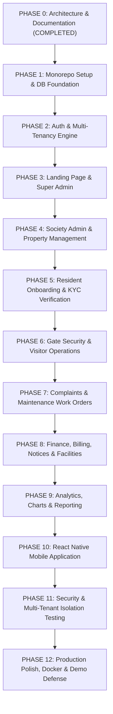

# Society360 — Implementation Roadmap & Execution Plan

**Document Version:** 1.0.0  
**Methodology:** Iterative Phase-Gated Engineering  
**Scope:** Full-Stack Web Application, Mobile Blueprint, Multi-Tenant Engine, Comprehensive Seed Data, and End-to-End Viva Demonstration Workflows  

---

## 1. Roadmap Phase Progression

---

## 2. Phase-by-Phase Execution Milestones

### PHASE 0 — Repository Inspection & Architecture (Current)
- **Goal:** Comprehensive system blueprint, requirements alignment, and architectural foundation.
- **Deliverables:**
  - `docs/01_PRODUCT_REQUIREMENTS_DOCUMENT.md`
  - `docs/02_SYSTEM_ARCHITECTURE.md`
  - `docs/03_DATABASE_ERD_AND_SCHEMA.md`
  - `docs/04_ROLE_BASED_ACCESS_CONTROL_MATRIX.md`
  - `docs/05_API_DEVELOPMENT_PLAN.md`
  - `docs/06_IMPLEMENTATION_ROADMAP.md`
- **Gate:** Architectural approval and clear design contracts established.

---

### PHASE 1 — Project Setup & Database Foundation
- **Goal:** Initialize monorepo directory layout, create backend Spring Boot scaffold with Maven wrapper, configure frontend Vite + React + TypeScript + Tailwind CSS project.
- **Key Deliverables:**
  - Backend project structure with `pom.xml`, Spring Boot 3.x, Spring Data JPA, Spring Security, Validation, PostgreSQL driver, and H2 database fallback for dev.
  - Frontend scaffold: Vite + React 18 + TypeScript + Tailwind CSS + Lucide icons + React Router.
  - Database schema DDL migrations (`V1__init_schema.sql`).
  - Base `ApiResponse` wrapper, `BaseEntity` with audit timestamps (`createdAt`, `updatedAt`).

---

### PHASE 2 — Authentication & Multi-Tenancy Engine
- **Goal:** Deliver working JWT authentication, tenant context interceptor, and secure password handling.
- **Key Deliverables:**
  - `UserAccount`, `Role`, `RefreshToken` entities and repositories.
  - BCrypt password encoder configuration.
  - `JwtTokenProvider`, `JwtAuthenticationFilter`, `TenantContextHolder` (ThreadLocal).
  - Auth endpoints: `/login`, `/register`, `/refresh-token`, `/logout`, `/me`, `/demo-accounts`.
  - Frontend `AuthContext`, token persistence, Axios request/response interceptors with auto-refresh.
  - Demonstration login page with 1-click credentials for all 7 roles.

---

### PHASE 3 — Public Landing Page & Super Admin Module
- **Goal:** High-converting SaaS public website and complete Platform Super Admin governance portal.
- **Key Deliverables:**
  - Public marketing website: Hero, Features, How it Works, Roles showcase, Security credentials, CTA, Multi-step Society Onboarding application.
  - Super Admin Dashboard: Global platform metrics (total societies, pending applications, active residents, system health).
  - Society Application Management: Review application, inspect docs, approve (provisions society + admin account) or reject with reason.
  - Society Workspace Management: Suspend / reactivate societies with immediate authorization lockouts.

---

### PHASE 4 — Society Administration & Property Management
- **Goal:** Complete physical infrastructure modeling for residential societies.
- **Key Deliverables:**
  - Society Admin Dashboard with property overview cards and quick actions.
  - Hierarchical property builder: Society $\to$ Buildings $\to$ Wings $\to$ Floors $\to$ Flats.
  - Validation to prevent duplicate flat numbers within wings/buildings.
  - Society Profile and Settings configuration (billing rules, gate policies).

---

### PHASE 5 — Resident Onboarding & KYC Verification
- **Goal:** Self-service resident joining flow with administrative KYC verification.
- **Key Deliverables:**
  - Resident join request modal: Select building, wing, flat number, resident type (`OWNER` or `TENANT`), upload proof.
  - Admin verification queue: Review resident applications, inspect proofs, approve or reject with comments.
  - State machine enforcing that unverified accounts cannot access tenant operations.
  - Society resident directory with role badges and privacy phone masking.

---

### PHASE 6 — Gate Security & Visitor Operations
- **Goal:** High-efficiency guard gatekeeper console and resident pre-approval pass workflow.
- **Key Deliverables:**
  - Security Guard high-contrast dashboard: Today's visitors, active visitors inside society, pending entry requests.
  - Walk-in visitor entry registration with host flat lookup.
  - Resident pre-approved pass generation (6-digit PIN pass).
  - Real-time visitor approval/rejection action for host residents.
  - Visitor check-out flow with automatic duration calculation and prevention of duplicate active entries.

---

### PHASE 7 — Complaints & Maintenance Work Orders
- **Goal:** Complete ticketing lifecycle for residential maintenance issues.
- **Key Deliverables:**
  - Resident complaint filing with categories (`PLUMBING`, `ELECTRICAL`, `CIVIL`, `COMMON_AREA`), priority ratings, and photo evidence.
  - Society Admin / Committee triage console: Assign complaints to maintenance staff.
  - Maintenance Staff dedicated mobile-friendly queue: Update task progress, attach resolution notes, mark completed.
  - Status lifecycle tracking (`SUBMITTED` $\to$ `ASSIGNED` $\to$ `IN_PROGRESS` $\to$ `RESOLVED` $\to$ `CLOSED`).

---

### PHASE 8 — Finance, Invoicing, Notices & Facilities
- **Goal:** Accounting, billing engine, shared facility reservation, and community notice board.
- **Key Deliverables:**
  - Batch maintenance invoice generator for occupied flats.
  - Resident financial portal: View unpaid invoices, dues ledger, payment history.
  - Interactive Simulated Payment Gateway (extensible architecture ready for Razorpay).
  - Official PDF/printable payment receipt generator.
  - Facility catalog and calendar reservation engine with database concurrency lock against double-booking.
  - Notice board with emergency broadcast alerts and read-receipt tracking.

---

### PHASE 9 — Analytics & Reporting Engine
- **Goal:** Rich visual analytics dashboards using Recharts for all executive and operational roles.
- **Key Deliverables:**
  - Super Admin: Platform growth metrics, cross-society comparisons.
  - Society Admin & Committee: Financial collection efficiency, aging of outstanding dues, MTTR complaint resolution curves, visitor footfall patterns.
  - Exportable CSV/PDF reports.

---

### PHASE 10 — Mobile Application (React Native Blueprint)
- **Goal:** Deliver React Native mobile client targeting Resident and Guard workflows using the exact same backend REST APIs.
- **Key Deliverables:**
  - Mobile screens: Resident Gate Pass Approval, Quick Complaint Submission, Notices, Gate Guard QR/PIN Scanner.

---

### PHASE 11 — Security & Multi-Tenant Isolation Testing
- **Goal:** Rigorous automated and manual penetration/isolation testing.
- **Key Deliverables:**
  - Tenant boundary tests: Society A user attempting to read/write Society B data $\to$ guaranteed HTTP 403.
  - Role escalation tests: Resident attempting to trigger administrative endpoints $\to$ guaranteed HTTP 403.
  - Concurrency test: Simultaneous booking of the identical facility slot $\to$ only one succeeds.

---

### PHASE 12 — UI Polish, Documentation & Deployment
- **Goal:** Production packaging, comprehensive documentation, and seamless viva demonstration readiness.
- **Key Deliverables:**
  - Docker Compose configuration (`frontend`, `backend`, `postgresql`).
  - Production build verification (`npm run build`, backend JAR packaging).
  - Comprehensive `README.md`, Viva Guide, Demo credentials cheat sheet, and Video Walkthrough script.
