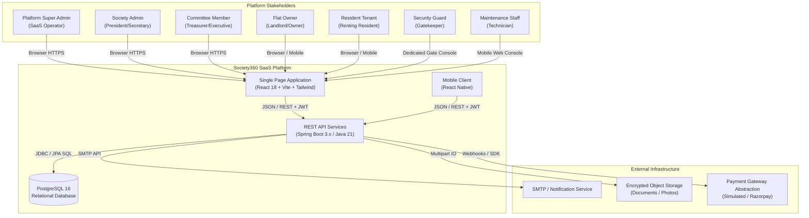
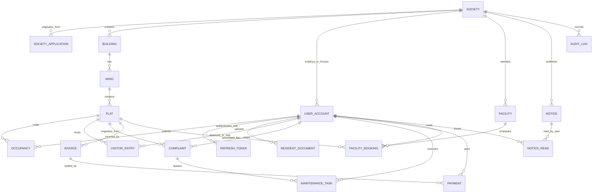
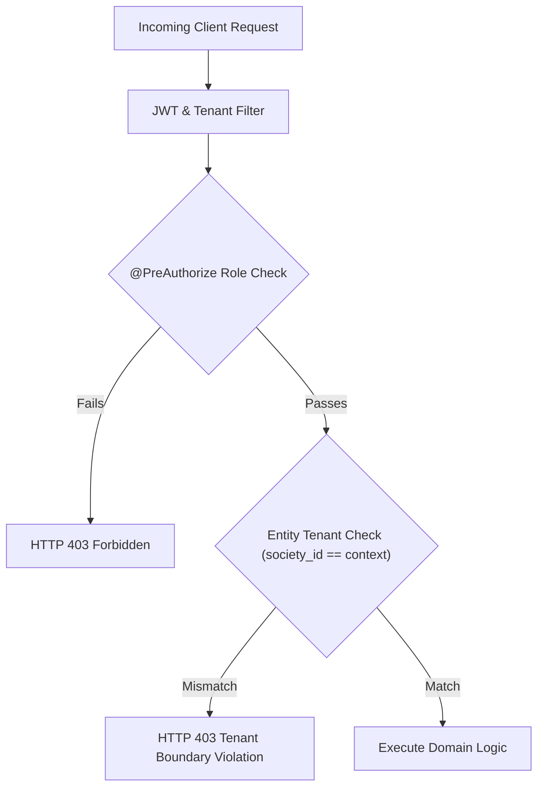
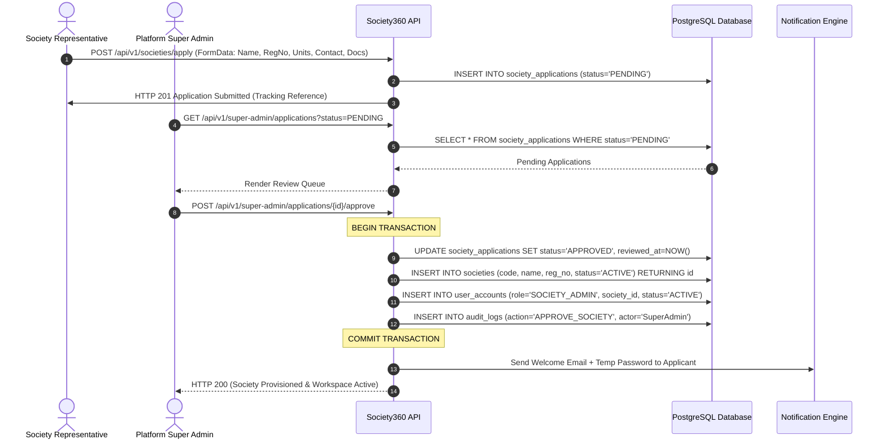
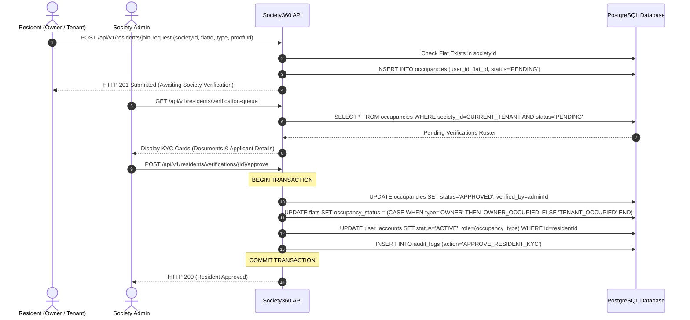
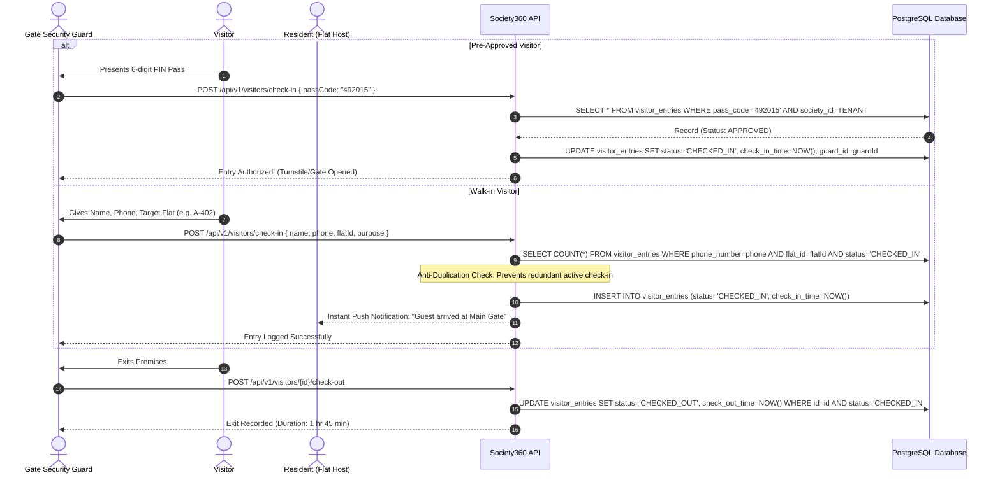
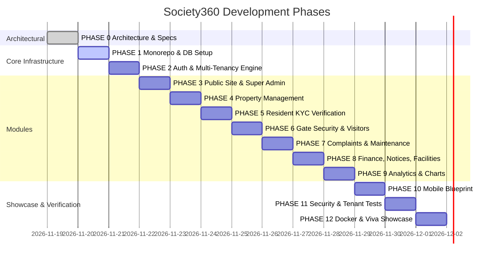

# Society360 — Master Technical Blueprint & Architecture Specification

**Project:** Society360 — Multi-Tenant Residential Society Management Platform  
**Document Type:** Master Technical Architecture Blueprint (Pre-Implementation Review)  
**Standard:** Enterprise SaaS Architecture Specification  
**Tech Stack:** React 18 (Vite, TypeScript, Tailwind CSS) + Java 21 Spring Boot 3.x + PostgreSQL 16  
**Primary Reference:** *"A Multi-Tenant Digital Platform for Residential Society Management"*  
**Author:** Senior Software Architect, Security & Database Architect  

---

## Table of Contents
1. [Executive Summary & Core Architectural Principles](#1-executive-summary--core-architectural-principles)
2. [System Architecture Diagram & C4 Models](#2-system-architecture-diagram--c4-models)
3. [Database Entity-Relationship (ER) Diagram](#3-database-entity-relationship-er-diagram)
4. [Database Table Definitions & Relational Schema (DDL)](#4-database-table-definitions--relational-schema-ddl)
5. [Seven-Role Permission & RBAC Matrix](#5-seven-role-permission--rbac-matrix)
6. [Multi-Tenant Isolation Strategy & Context Engine](#6-multi-tenant-isolation-strategy--context-engine)
7. [End-to-End Core Lifecycle Workflows](#7-end-to-end-core-lifecycle-workflows)
   - 7.1 Society Registration & Super Admin Approval Lifecycle
   - 7.2 Tenant Workspace Creation & Provisioning
   - 7.3 Resident Onboarding & KYC Verification Workflow
   - 7.4 Gatekeeper Visitor & Anti-Duplication Flow
8. [REST API Endpoint Specification](#8-rest-api-endpoint-specification)
9. [Frontend Component Architecture & UI Design System](#9-frontend-component-architecture--ui-design-system)
10. [Backend Package Architecture & Code Organization](#10-backend-package-architecture--code-organization)
11. [Development Milestones & Phase-Gated Roadmap](#11-development-milestones--phase-gated-roadmap)
12. [Security, Concurrency & Testing Strategy](#12-security-concurrency--testing-strategy)
13. [Architectural Risks & Pre-Emptive Resolutions](#13-architectural-risks--pre-emptive-resolutions)

---

## 1. Executive Summary & Core Architectural Principles

Society360 is a cloud-native, multi-tenant software-as-a-service (SaaS) platform built to manage end-to-end residential community operations. Addressing common issues in residential communities—such as paper gate registers, un-audited maintenance collections, uncoordinated maintenance complaints, and conflicting amenity bookings—Society360 consolidates multiple independent residential societies onto a unified, cost-effective infrastructure while guaranteeing strict logical data partitioning.

### Core Architectural Principles:
1. **Server-Derived Tenant Identity (Zero-Trust Client):** `society_id` is never trusted from client request parameters. It is cryptographically derived from the verified JWT claims and injected into a thread-scoped context.
2. **Dual-Layer Authorization:** Every operation is evaluated at both the HTTP security filter layer (via `@PreAuthorize` role checks) and the service/data access layer (via tenant ownership assertion).
3. **Database Integrity & Concurrency Control:** Concurrency locks protect shared resources (such as facility bookings and active visitor check-ins) against race conditions.
4. **Clean Layered Architecture:** Decoupled progression from REST Controllers $\to$ Application Services $\to$ Data Repositories $\to$ Relational Storage, mediated by strongly validated DTOs.
5. **Auditable Governance:** All privileged administrative actions, state transitions, and billing operations emit immutable structured audit log entries.

---

## 2. System Architecture Diagram & C4 Models

### 2.1 C4 Level 1: System Context Diagram
The System Context diagram illustrates the platform boundaries, external actors, and third-party systems.



### 2.2 C4 Level 2: Container Diagram
Details the internal container topology of the Spring Boot application and client boundaries.

```mermaid
graph TD
    subgraph FrontendApp["Frontend Application (React 18 SPA)"]
        Router["React Router 6 (Protected Guards)"]
        AuthCtx["Auth Context (JWT State)"]
        AxiosClient["Axios Interceptor (Auth & Tenant Headers)"]
        Views["7 Role-Specific Layout Shells & Views"]
    end

    subgraph BackendApp["Backend Application (Spring Boot 3.x)"]
        SecurityChain["Spring Security 6 Filter Chain"]
        JWTFilter["JWT Authentication & Validation Filter"]
        TenantFilter["TenantContextFilter (ThreadLocal Injector)"]
        
        subgraph DomainControllers["REST Controllers"]
            C_Auth["AuthController"]
            C_Super["SuperAdminController"]
            C_Society["SocietyController"]
            C_Prop["PropertyController"]
            C_Res["ResidentController"]
            C_Gate["VisitorSecurityController"]
            C_Maint["ComplaintMaintenanceController"]
            C_Fin["FinanceBillingController"]
            C_Fac["FacilityNoticeController"]
        end

        subgraph ServiceLayer["Transactional Business Services"]
            S_Auth["AuthenticationService"]
            S_Tenant["TenantProvisioningService"]
            S_Prop["PropertyHierarchyService"]
            S_Gate["GateSecurityService"]
            S_Ticket["ComplaintWorkflowEngine"]
            S_Bill["BillingAndLedgerService"]
            S_Lock["ConcurrencyLockService"]
        end

        subgraph RepoLayer["Data Repositories (Spring Data JPA)"]
            R_Tenant["TenantAwareBaseRepository<T>"]
            R_Audit["AuditLogRepository"]
        end
    end

    subgraph Storage["Persistent Storage"]
        DB[(PostgreSQL 16 Engine)]
    end

    Views --> Router
    Router --> AuthCtx
    AuthCtx --> AxiosClient
    AxiosClient -->|HTTPS + Bearer Token| SecurityChain
    SecurityChain --> JWTFilter
    JWTFilter --> TenantFilter
    TenantFilter --> DomainControllers
    DomainControllers --> ServiceLayer
    ServiceLayer --> RepoLayer
    RepoLayer --> DB
```



---

## 3. Database Entity-Relationship (ER) Diagram

The system employs a 20-entity normalized schema. The diagram below details entity relationships, foreign key linkages, and tenant discriminator attachments.



---

## 4. Database Table Definitions & Relational Schema (DDL)

```sql
-- ============================================================================
-- EXTENSIONS & CUSTOM DOMAINS
-- ============================================================================
CREATE EXTENSION IF NOT EXISTS "uuid-ossp";

-- ============================================================================
-- 1. SOCIETIES & TENANCY WORKSPACES
-- ============================================================================
CREATE TABLE societies (
    id UUID PRIMARY KEY DEFAULT uuid_generate_v4(),
    code VARCHAR(30) NOT NULL UNIQUE,
    name VARCHAR(150) NOT NULL,
    registration_number VARCHAR(80) NOT NULL UNIQUE,
    address_line TEXT NOT NULL,
    city VARCHAR(80) NOT NULL,
    state VARCHAR(80) NOT NULL,
    pin_code VARCHAR(12) NOT NULL,
    status VARCHAR(25) NOT NULL DEFAULT 'ACTIVE' 
        CHECK (status IN ('ACTIVE', 'SUSPENDED', 'INACTIVE')),
    settings JSONB DEFAULT '{"billingCycle":"MONTHLY","lateFeePercentage":5.0,"visitorCurfew":"23:00"}'::jsonb,
    created_at TIMESTAMPTZ NOT NULL DEFAULT CURRENT_TIMESTAMP,
    updated_at TIMESTAMPTZ NOT NULL DEFAULT CURRENT_TIMESTAMP
);

CREATE INDEX idx_societies_status ON societies(status);

-- ============================================================================
-- 2. SOCIETY ONBOARDING APPLICATIONS
-- ============================================================================
CREATE TABLE society_applications (
    id UUID PRIMARY KEY DEFAULT uuid_generate_v4(),
    society_name VARCHAR(150) NOT NULL,
    registration_number VARCHAR(80) NOT NULL,
    address_line TEXT NOT NULL,
    city VARCHAR(80) NOT NULL,
    state VARCHAR(80) NOT NULL,
    pin_code VARCHAR(12) NOT NULL,
    building_count INT NOT NULL CHECK (building_count > 0),
    flat_count INT NOT NULL CHECK (flat_count > 0),
    applicant_name VARCHAR(100) NOT NULL,
    applicant_email VARCHAR(120) NOT NULL,
    applicant_phone VARCHAR(20) NOT NULL,
    document_url VARCHAR(255),
    status VARCHAR(35) NOT NULL DEFAULT 'PENDING'
        CHECK (status IN ('PENDING', 'UNDER_REVIEW', 'APPROVED', 'REJECTED', 'ADDITIONAL_INFORMATION_REQUIRED')),
    rejection_reason TEXT,
    reviewed_by UUID,
    reviewed_at TIMESTAMPTZ,
    created_at TIMESTAMPTZ NOT NULL DEFAULT CURRENT_TIMESTAMP,
    updated_at TIMESTAMPTZ NOT NULL DEFAULT CURRENT_TIMESTAMP
);

CREATE INDEX idx_society_apps_status ON society_applications(status);

-- ============================================================================
-- 3. USER ACCOUNTS & IDENTITY
-- ============================================================================
CREATE TABLE user_accounts (
    id UUID PRIMARY KEY DEFAULT uuid_generate_v4(),
    society_id UUID REFERENCES societies(id) ON DELETE RESTRICT,
    full_name VARCHAR(100) NOT NULL,
    email VARCHAR(120) NOT NULL UNIQUE,
    phone VARCHAR(20) NOT NULL,
    password_hash VARCHAR(255) NOT NULL,
    role VARCHAR(35) NOT NULL CHECK (role IN (
        'PLATFORM_SUPER_ADMIN',
        'SOCIETY_ADMIN',
        'COMMITTEE_MEMBER',
        'FLAT_OWNER',
        'TENANT',
        'SECURITY_GUARD',
        'MAINTENANCE_STAFF'
    )),
    status VARCHAR(25) NOT NULL DEFAULT 'ACTIVE'
        CHECK (status IN ('PENDING_VERIFICATION', 'ACTIVE', 'SUSPENDED', 'DEACTIVATED')),
    avatar_url VARCHAR(255),
    created_at TIMESTAMPTZ NOT NULL DEFAULT CURRENT_TIMESTAMP,
    updated_at TIMESTAMPTZ NOT NULL DEFAULT CURRENT_TIMESTAMP
);

CREATE INDEX idx_users_society_id ON user_accounts(society_id);
CREATE INDEX idx_users_email ON user_accounts(email);
CREATE INDEX idx_users_role ON user_accounts(role);

-- ============================================================================
-- 4. REFRESH TOKENS
-- ============================================================================
CREATE TABLE refresh_tokens (
    id UUID PRIMARY KEY DEFAULT uuid_generate_v4(),
    user_id UUID NOT NULL REFERENCES user_accounts(id) ON DELETE CASCADE,
    token VARCHAR(255) NOT NULL UNIQUE,
    expires_at TIMESTAMPTZ NOT NULL,
    revoked BOOLEAN NOT NULL DEFAULT FALSE,
    created_at TIMESTAMPTZ NOT NULL DEFAULT CURRENT_TIMESTAMP
);

CREATE INDEX idx_refresh_tokens_user ON refresh_tokens(user_id);

-- ============================================================================
-- 5. PHYSICAL PROPERTY HIERARCHY: BUILDINGS, WINGS, FLATS
-- ============================================================================
CREATE TABLE buildings (
    id UUID PRIMARY KEY DEFAULT uuid_generate_v4(),
    society_id UUID NOT NULL REFERENCES societies(id) ON DELETE CASCADE,
    name VARCHAR(80) NOT NULL,
    total_floors INT NOT NULL DEFAULT 1 CHECK (total_floors >= 1),
    description TEXT,
    created_at TIMESTAMPTZ NOT NULL DEFAULT CURRENT_TIMESTAMP,
    CONSTRAINT uq_society_building UNIQUE (society_id, name)
);

CREATE INDEX idx_buildings_society_id ON buildings(society_id);

CREATE TABLE wings (
    id UUID PRIMARY KEY DEFAULT uuid_generate_v4(),
    society_id UUID NOT NULL REFERENCES societies(id) ON DELETE CASCADE,
    building_id UUID NOT NULL REFERENCES buildings(id) ON DELETE CASCADE,
    name VARCHAR(30) NOT NULL,
    created_at TIMESTAMPTZ NOT NULL DEFAULT CURRENT_TIMESTAMP,
    CONSTRAINT uq_building_wing UNIQUE (building_id, name)
);

CREATE INDEX idx_wings_society_id ON wings(society_id);

CREATE TABLE flats (
    id UUID PRIMARY KEY DEFAULT uuid_generate_v4(),
    society_id UUID NOT NULL REFERENCES societies(id) ON DELETE CASCADE,
    building_id UUID NOT NULL REFERENCES buildings(id) ON DELETE CASCADE,
    wing_id UUID NOT NULL REFERENCES wings(id) ON DELETE CASCADE,
    flat_number VARCHAR(30) NOT NULL,
    floor_number INT NOT NULL,
    flat_type VARCHAR(30) NOT NULL CHECK (flat_type IN ('STUDIO', '1BHK', '2BHK', '3BHK', '4BHK', 'PENTHOUSE', 'VILLA')),
    square_feet NUMERIC(8,2) NOT NULL CHECK (square_feet > 0),
    occupancy_status VARCHAR(30) NOT NULL DEFAULT 'VACANT'
        CHECK (occupancy_status IN ('VACANT', 'OWNER_OCCUPIED', 'TENANT_OCCUPIED')),
    created_at TIMESTAMPTZ NOT NULL DEFAULT CURRENT_TIMESTAMP,
    CONSTRAINT uq_wing_flat UNIQUE (wing_id, flat_number)
);

CREATE INDEX idx_flats_society_id ON flats(society_id);
CREATE INDEX idx_flats_building_wing ON flats(building_id, wing_id);

-- ============================================================================
-- 6. OCCUPANCY (RESIDENT-FLAT MAPPING & KYC)
-- ============================================================================
CREATE TABLE occupancies (
    id UUID PRIMARY KEY DEFAULT uuid_generate_v4(),
    society_id UUID NOT NULL REFERENCES societies(id) ON DELETE CASCADE,
    flat_id UUID NOT NULL REFERENCES flats(id) ON DELETE CASCADE,
    user_id UUID NOT NULL REFERENCES user_accounts(id) ON DELETE CASCADE,
    occupancy_type VARCHAR(20) NOT NULL CHECK (occupancy_type IN ('OWNER', 'TENANT')),
    status VARCHAR(30) NOT NULL DEFAULT 'PENDING'
        CHECK (status IN ('PENDING', 'UNDER_REVIEW', 'APPROVED', 'REJECTED', 'VACATED')),
    document_proof_url VARCHAR(255),
    rejection_reason TEXT,
    verified_by UUID REFERENCES user_accounts(id),
    verified_at TIMESTAMPTZ,
    created_at TIMESTAMPTZ NOT NULL DEFAULT CURRENT_TIMESTAMP,
    updated_at TIMESTAMPTZ NOT NULL DEFAULT CURRENT_TIMESTAMP
);

CREATE INDEX idx_occupancies_society ON occupancies(society_id);
CREATE INDEX idx_occupancies_flat_user ON occupancies(flat_id, user_id);

-- ============================================================================
-- 7. GATEKEEPING & VISITOR LOGS
-- ============================================================================
CREATE TABLE visitor_entries (
    id UUID PRIMARY KEY DEFAULT uuid_generate_v4(),
    society_id UUID NOT NULL REFERENCES societies(id) ON DELETE CASCADE,
    flat_id UUID NOT NULL REFERENCES flats(id) ON DELETE CASCADE,
    visitor_name VARCHAR(100) NOT NULL,
    phone_number VARCHAR(20) NOT NULL,
    purpose VARCHAR(100) NOT NULL CHECK (purpose IN ('GUEST', 'DELIVERY', 'CAB', 'SERVICE_REPAIR', 'MAINTENANCE', 'OTHER')),
    entry_type VARCHAR(30) NOT NULL CHECK (entry_type IN ('WALK_IN', 'PRE_APPROVED')),
    pass_code VARCHAR(10),
    status VARCHAR(30) NOT NULL DEFAULT 'EXPECTED'
        CHECK (status IN ('EXPECTED', 'PENDING_APPROVAL', 'APPROVED', 'CHECKED_IN', 'CHECKED_OUT', 'REJECTED')),
    check_in_time TIMESTAMPTZ,
    check_out_time TIMESTAMPTZ,
    guard_id UUID REFERENCES user_accounts(id),
    approved_by UUID REFERENCES user_accounts(id),
    vehicle_number VARCHAR(30),
    photo_url VARCHAR(255),
    created_at TIMESTAMPTZ NOT NULL DEFAULT CURRENT_TIMESTAMP
);

CREATE INDEX idx_visitors_society_status ON visitor_entries(society_id, status);
CREATE INDEX idx_visitors_flat ON visitor_entries(flat_id);

-- ============================================================================
-- 8. COMPLAINTS & MAINTENANCE
-- ============================================================================
CREATE TABLE complaints (
    id UUID PRIMARY KEY DEFAULT uuid_generate_v4(),
    society_id UUID NOT NULL REFERENCES societies(id) ON DELETE CASCADE,
    flat_id UUID NOT NULL REFERENCES flats(id) ON DELETE CASCADE,
    created_by UUID NOT NULL REFERENCES user_accounts(id),
    ticket_number VARCHAR(40) NOT NULL UNIQUE,
    title VARCHAR(150) NOT NULL,
    category VARCHAR(40) NOT NULL CHECK (category IN ('PLUMBING', 'ELECTRICAL', 'CIVIL', 'SECURITY', 'COMMON_AREA', 'LIFT', 'CLEANLINESS', 'OTHER')),
    priority VARCHAR(20) NOT NULL DEFAULT 'MEDIUM' CHECK (priority IN ('LOW', 'MEDIUM', 'HIGH', 'EMERGENCY')),
    description TEXT NOT NULL,
    status VARCHAR(30) NOT NULL DEFAULT 'SUBMITTED'
        CHECK (status IN ('SUBMITTED', 'ASSIGNED', 'IN_PROGRESS', 'RESOLVED', 'CLOSED')),
    photo_url VARCHAR(255),
    assigned_to UUID REFERENCES user_accounts(id),
    resolution_notes TEXT,
    resolved_at TIMESTAMPTZ,
    created_at TIMESTAMPTZ NOT NULL DEFAULT CURRENT_TIMESTAMP,
    updated_at TIMESTAMPTZ NOT NULL DEFAULT CURRENT_TIMESTAMP
);

CREATE INDEX idx_complaints_society_status ON complaints(society_id, status);

-- ============================================================================
-- 9. FINANCIAL BILLING, INVOICES & PAYMENTS
-- ============================================================================
CREATE TABLE invoices (
    id UUID PRIMARY KEY DEFAULT uuid_generate_v4(),
    society_id UUID NOT NULL REFERENCES societies(id) ON DELETE CASCADE,
    flat_id UUID NOT NULL REFERENCES flats(id) ON DELETE CASCADE,
    invoice_number VARCHAR(50) NOT NULL UNIQUE,
    billing_month VARCHAR(20) NOT NULL,
    amount NUMERIC(10,2) NOT NULL CHECK (amount >= 0),
    late_fee NUMERIC(8,2) NOT NULL DEFAULT 0.00 CHECK (late_fee >= 0),
    due_date DATE NOT NULL,
    status VARCHAR(25) NOT NULL DEFAULT 'UNPAID'
        CHECK (status IN ('UNPAID', 'PAID', 'OVERDUE', 'CANCELLED')),
    description TEXT,
    created_at TIMESTAMPTZ NOT NULL DEFAULT CURRENT_TIMESTAMP,
    updated_at TIMESTAMPTZ NOT NULL DEFAULT CURRENT_TIMESTAMP
);

CREATE INDEX idx_invoices_society_flat ON invoices(society_id, flat_id);
CREATE INDEX idx_invoices_status ON invoices(status);

CREATE TABLE payments (
    id UUID PRIMARY KEY DEFAULT uuid_generate_v4(),
    society_id UUID NOT NULL REFERENCES societies(id) ON DELETE CASCADE,
    invoice_id UUID NOT NULL REFERENCES invoices(id) ON DELETE CASCADE,
    paid_by UUID NOT NULL REFERENCES user_accounts(id),
    receipt_number VARCHAR(50) NOT NULL UNIQUE,
    amount_paid NUMERIC(10,2) NOT NULL CHECK (amount_paid > 0),
    payment_method VARCHAR(30) NOT NULL CHECK (payment_method IN ('SIMULATED_GATEWAY', 'UPI', 'CREDIT_CARD', 'NET_BANKING', 'CASH_OFFLINE')),
    transaction_reference VARCHAR(100) NOT NULL UNIQUE,
    payment_status VARCHAR(25) NOT NULL DEFAULT 'SUCCESS' CHECK (payment_status IN ('SUCCESS', 'FAILED', 'PENDING')),
    paid_at TIMESTAMPTZ NOT NULL DEFAULT CURRENT_TIMESTAMP
);

CREATE INDEX idx_payments_society_invoice ON payments(society_id, invoice_id);

-- ============================================================================
-- 10. FACILITIES & ANTI-DOUBLE-BOOKING ENGINE
-- ============================================================================
CREATE TABLE facilities (
    id UUID PRIMARY KEY DEFAULT uuid_generate_v4(),
    society_id UUID NOT NULL REFERENCES societies(id) ON DELETE CASCADE,
    name VARCHAR(100) NOT NULL,
    capacity INT NOT NULL CHECK (capacity > 0),
    booking_charge_per_hour NUMERIC(8,2) NOT NULL DEFAULT 0.00,
    opening_time TIME NOT NULL,
    closing_time TIME NOT NULL,
    status VARCHAR(20) NOT NULL DEFAULT 'ACTIVE' CHECK (status IN ('ACTIVE', 'MAINTENANCE')),
    created_at TIMESTAMPTZ NOT NULL DEFAULT CURRENT_TIMESTAMP
);

CREATE INDEX idx_facilities_society ON facilities(society_id);

CREATE TABLE facility_bookings (
    id UUID PRIMARY KEY DEFAULT uuid_generate_v4(),
    society_id UUID NOT NULL REFERENCES societies(id) ON DELETE CASCADE,
    facility_id UUID NOT NULL REFERENCES facilities(id) ON DELETE CASCADE,
    booked_by UUID NOT NULL REFERENCES user_accounts(id),
    flat_id UUID NOT NULL REFERENCES flats(id),
    booking_date DATE NOT NULL,
    start_time TIME NOT NULL,
    end_time TIME NOT NULL,
    status VARCHAR(25) NOT NULL DEFAULT 'CONFIRMED'
        CHECK (status IN ('PENDING', 'CONFIRMED', 'CANCELLED', 'REJECTED')),
    total_cost NUMERIC(8,2) NOT NULL DEFAULT 0.00,
    created_at TIMESTAMPTZ NOT NULL DEFAULT CURRENT_TIMESTAMP,
    CONSTRAINT ck_booking_times CHECK (end_time > start_time)
);

CREATE INDEX idx_bookings_facility_date ON facility_bookings(facility_id, booking_date, status);

-- ============================================================================
-- 11. NOTICES & AUDIT LOGS
-- ============================================================================
CREATE TABLE notices (
    id UUID PRIMARY KEY DEFAULT uuid_generate_v4(),
    society_id UUID NOT NULL REFERENCES societies(id) ON DELETE CASCADE,
    title VARCHAR(200) NOT NULL,
    content TEXT NOT NULL,
    notice_type VARCHAR(30) NOT NULL CHECK (notice_type IN ('GENERAL', 'EMERGENCY', 'MAINTENANCE', 'EVENT', 'POLL')),
    priority VARCHAR(20) NOT NULL DEFAULT 'NORMAL' CHECK (priority IN ('NORMAL', 'URGENT', 'CRITICAL')),
    published_by UUID NOT NULL REFERENCES user_accounts(id),
    expires_at TIMESTAMPTZ,
    created_at TIMESTAMPTZ NOT NULL DEFAULT CURRENT_TIMESTAMP
);

CREATE INDEX idx_notices_society ON notices(society_id);

CREATE TABLE notice_reads (
    id UUID PRIMARY KEY DEFAULT uuid_generate_v4(),
    notice_id UUID NOT NULL REFERENCES notices(id) ON DELETE CASCADE,
    user_id UUID NOT NULL REFERENCES user_accounts(id) ON DELETE CASCADE,
    read_at TIMESTAMPTZ NOT NULL DEFAULT CURRENT_TIMESTAMP,
    CONSTRAINT uq_notice_user_read UNIQUE (notice_id, user_id)
);

CREATE TABLE audit_logs (
    id UUID PRIMARY KEY DEFAULT uuid_generate_v4(),
    society_id UUID,
    user_id UUID,
    user_email VARCHAR(120),
    action VARCHAR(100) NOT NULL,
    resource_type VARCHAR(50) NOT NULL,
    resource_id VARCHAR(100),
    ip_address VARCHAR(45),
    details JSONB,
    created_at TIMESTAMPTZ NOT NULL DEFAULT CURRENT_TIMESTAMP
);

CREATE INDEX idx_audit_logs_society_action ON audit_logs(society_id, action);
```

---

## 5. Seven-Role Permission & RBAC Matrix

Dual-layer RBAC is enforced:
1. **API Layer (`@PreAuthorize`):** Method-level role requirements in Spring Security.
2. **Context Layer (Tenant Isolation):** Entity-level scoping verifying the subject's `society_id`.



### 5.1 RBAC Matrix

| System Domain | PLATFORM_SUPER_ADMIN | SOCIETY_ADMIN | COMMITTEE_MEMBER | FLAT_OWNER | TENANT | SECURITY_GUARD | MAINTENANCE_STAFF |
| :--- | :---: | :---: | :---: | :---: | :---: | :---: | :---: |
| **Society Applications** | `READ_ALL`, `APPROVE`, `REJECT` | — | — | — | — | — | — |
| **Society Workspace & Status** | `READ_ALL`, `SUSPEND`, `ACTIVATE` | `READ_OWN`, `UPDATE_SETTINGS` | `READ_OWN` | `READ_OWN` | `READ_OWN` | `READ_OWN` | — |
| **Buildings, Wings, Flats** | `READ_ALL` | `CREATE`, `READ_ALL`, `UPDATE`, `DELETE` | `READ_ALL` | `READ_OWN` | `READ_OWN` | `LOOKUP_FLATS` | `LOOKUP_FLATS` |
| **Resident Verification (KYC)** | `READ_ALL` | `READ_ALL`, `APPROVE`, `REJECT` | `READ_ALL`, `APPROVE` | `SUBMIT_OWN` | `SUBMIT_OWN` | — | — |
| **Resident Directory** | — | `READ_ALL`, `MANAGE` | `READ_ALL` | `READ_PUBLIC` | `READ_PUBLIC` | `LOOKUP_NAME` | — |
| **Gatekeeper Visitor Logs** | — | `READ_ALL` | `READ_ALL` | `READ_OWN`, `APPROVE_GATE` | `READ_OWN`, `APPROVE_GATE` | `CREATE_ENTRY`, `CHECK_IN`, `CHECK_OUT` | — |
| **Pre-Approved Guest Passes** | — | `READ_ALL` | `READ_ALL` | `CREATE`, `REVOKE` | `CREATE`, `REVOKE` | `VERIFY_PASS` | — |
| **Complaints (Tickets)** | — | `READ_ALL`, `ASSIGN`, `CLOSE` | `READ_ALL` | `CREATE`, `READ_OWN` | `CREATE`, `READ_OWN` | — | `READ_ASSIGNED`, `UPDATE_STATUS` |
| **Maintenance Work Orders** | — | `CREATE`, `READ_ALL`, `ASSIGN` | `READ_ALL` | — | — | — | `READ_ASSIGNED`, `EXECUTE`, `RESOLVE` |
| **Invoices & Billing** | — | `GENERATE_BATCH`, `READ_ALL`, `CANCEL` | `READ_ALL` | `READ_OWN` | `READ_OWN` | — | — |
| **Payments & Receipts** | — | `READ_ALL`, `MANUAL_RECONCILE` | `READ_ALL` | `PAY_SIMULATED`, `READ_OWN_RECEIPTS` | `PAY_SIMULATED`, `READ_OWN_RECEIPTS` | — | — |
| **Facility Registry** | — | `CREATE`, `UPDATE`, `DELETE` | `READ_ALL` | `READ_ALL` | `READ_ALL` | `READ_TODAY` | — |
| **Facility Bookings** | — | `READ_ALL`, `CANCEL_ADMIN` | `READ_ALL` | `CREATE_BOOKING`, `CANCEL_OWN` | `CREATE_BOOKING`, `CANCEL_OWN` | `READ_DAILY_ROSTER` | — |
| **Notices & Bulletins** | — | `PUBLISH`, `DELETE` | `PUBLISH` | `READ_ALL`, `VOTE_POLL` | `READ_ALL`, `VOTE_POLL` | `READ_ALL` | `READ_ALL` |
| **Audit Logs** | `GLOBAL_AUDIT_LOGS` | `SOCIETY_AUDIT_LOGS` | `SOCIETY_AUDIT_LOGS` | — | — | — | — |
| **Analytics Dashboards** | `PLATFORM_METRICS` | `SOCIETY_OPERATIONS` | `FINANCIAL_LEDGER` | `PERSONAL_PORTAL` | `PERSONAL_PORTAL` | `GATE_STATISTICS` | `WORKLOAD_QUEUE` |

---

## 6. Multi-Tenant Isolation Strategy & Context Engine

### 6.1 The Core Isolation Tenet
In a shared database model, a data leak occurs when a query omits the tenant constraint or trusts client-supplied tenant identifiers. Society360 prevents this through an immutable server-side identity chain.

### 6.2 Technical Implementation Flow
1. **JWT Construction:** On login, the authenticated user's approved `society_id` (UUID) is signed into the JWT payload as a standard claim:
   ```json
   {
     "sub": "user_uuid_here",
     "email": "secretary@greenfield.com",
     "role": "SOCIETY_ADMIN",
     "societyId": "a1b2c3d4-e5f6-7890-abcd-ef1234567890",
     "iat": 1763560000,
     "exp": 1763563600
   }
   ```
2. **Context Interceptor (`TenantContextFilter`):**
   - Implements `OncePerRequestFilter`.
   - Extracts `societyId` from the verified token.
   - Places it in `TenantContextHolder`:
     ```java
     public final class TenantContextHolder {
         private static final ThreadLocal<UUID> CURRENT_TENANT = new ThreadLocal<>();
         public static void setTenantId(UUID tenantId) { CURRENT_TENANT.set(tenantId); }
         public static UUID getTenantId() { return CURRENT_TENANT.get(); }
         public static void clear() { CURRENT_TENANT.remove(); }
     }
     ```
   - Invokes `clear()` in a mandatory `finally` block to prevent thread pool contamination in Tomcat/NIO worker threads.
3. **Repository-Level Enforcement:**
   - All tenant-owned repositories extend `TenantAwareRepository<T, ID>`:
     ```java
     @NoRepositoryBean
     public interface TenantAwareRepository<T extends TenantEntity, ID> extends JpaRepository<T, ID> {
         List<T> findAllBySocietyId(UUID societyId);
         Optional<T> findByIdAndSocietyId(ID id, UUID societyId);
         boolean existsByIdAndSocietyId(ID id, UUID societyId);
     }
     ```
4. **Service Boundary Guard:**
   - Any access by ID performs a verified lookup:
     ```java
     Flat flat = flatRepository.findByIdAndSocietyId(flatId, TenantContextHolder.getTenantId())
         .orElseThrow(() -> new TenantResourceNotFoundException("Flat not found or access denied"));
     ```

---

## 7. End-to-End Core Lifecycle Workflows

### 7.1 Society Registration & Super Admin Approval Lifecycle



### 7.2 Resident Onboarding & KYC Verification Workflow



### 7.3 Gatekeeper Visitor Operations & Anti-Duplication Flow



---

## 8. REST API Endpoint Specification

All REST APIs follow standard REST conventions and return an `ApiResponse<T>` envelope.

### 8.1 API Response Contract
```json
{
  "success": true,
  "message": "Operation completed successfully",
  "data": { ... },
  "timestamp": "2026-11-19T16:00:00Z"
}
```

### 8.2 Comprehensive Endpoint Roster

#### Authentication & Profile (`/api/v1/auth`)
- `POST /api/v1/auth/register` — Public registration
- `POST /api/v1/auth/login` — Returns JWT access + refresh token + role payload
- `POST /api/v1/auth/refresh-token` — Rotates tokens
- `POST /api/v1/auth/logout` — Revokes refresh token in database
- `GET /api/v1/auth/me` — Fetches authenticated profile & permissions
- `GET /api/v1/auth/demo-accounts` — Returns pre-seeded demo accounts across all 7 roles

#### Super Admin Platform Governance (`/api/v1/super-admin`)
- `GET /api/v1/super-admin/dashboard` — Platform stats (societies, active users, growth)
- `GET /api/v1/super-admin/applications` — List onboarding applications
- `POST /api/v1/super-admin/applications/{id}/approve` — Approve society & provision
- `POST /api/v1/super-admin/applications/{id}/reject` — Reject with reason
- `GET /api/v1/super-admin/societies` — List all registered societies
- `PATCH /api/v1/super-admin/societies/{id}/status` — Suspend / reactivate society
- `GET /api/v1/super-admin/audit-logs` — Global audit log feed

#### Society Configuration (`/api/v1/societies`)
- `POST /api/v1/societies/apply` — Public multi-step registration form
- `GET /api/v1/societies/public-list` — List active societies for dropdown selection
- `GET /api/v1/societies/current` — Current society profile
- `PUT /api/v1/societies/current` — Update society information
- `PUT /api/v1/societies/current/settings` — Update billing and security settings

#### Property Hierarchy (`/api/v1/buildings`, `/api/v1/flats`)
- `GET /api/v1/buildings` — List buildings in current society
- `POST /api/v1/buildings` — Add building
- `GET /api/v1/buildings/{id}/wings` — List wings of a building
- `POST /api/v1/buildings/{id}/wings` — Add wing
- `GET /api/v1/flats` — List flats (filterable by building, wing, occupancy)
- `POST /api/v1/flats` — Register new flat with unique constraint check
- `GET /api/v1/flats/{id}` — Retrieve flat details, resident history, and dues

#### Resident Onboarding & KYC (`/api/v1/residents`)
- `POST /api/v1/residents/join-request` — Resident joins flat (submits KYC proof)
- `GET /api/v1/residents/verification-queue` — Admin pending KYC queue
- `POST /api/v1/residents/verifications/{id}/approve` — Approve resident KYC
- `POST /api/v1/residents/verifications/{id}/reject` — Reject resident KYC
- `GET /api/v1/residents/directory` — Society member directory

#### Gatekeeping & Visitors (`/api/v1/visitors`)
- `POST /api/v1/visitors/pre-approve` — Resident creates expected pass (6-digit PIN)
- `POST /api/v1/visitors/check-in` — Guard checks in visitor (PIN pass or walk-in)
- `POST /api/v1/visitors/{id}/check-out` — Guard logs visitor departure
- `GET /api/v1/visitors/active` — Real-time list of visitors currently on-premise
- `GET /api/v1/visitors/my-visitors` — Resident visitor history and expected passes

#### Complaints & Maintenance (`/api/v1/complaints`)
- `POST /api/v1/complaints` — Resident files complaint ticket with photo
- `GET /api/v1/complaints` — List complaints (Role-scoped)
- `GET /api/v1/complaints/{id}` — Complaint details and resolution history
- `POST /api/v1/complaints/{id}/assign` — Admin assigns to maintenance staff
- `PATCH /api/v1/complaints/{id}/status` — Update progress (`IN_PROGRESS`, `RESOLVED`, `CLOSED`)

#### Billing & Finance (`/api/v1/finance`)
- `POST /api/v1/finance/invoices/generate-batch` — Batch generate maintenance bills
- `GET /api/v1/finance/invoices` — List invoices (Flat/Society scoped)
- `POST /api/v1/finance/payments/simulate` — Execute simulated digital payment
- `GET /api/v1/finance/receipts/{receiptNo}` — Download official PDF receipt
- `GET /api/v1/finance/reports/dues` — Outstanding dues ledger

#### Facilities & Notices (`/api/v1/facilities`, `/api/v1/notices`)
- `GET /api/v1/facilities` — Catalog of society amenities
- `GET /api/v1/facilities/{id}/availability` — Check slot availability
- `POST /api/v1/facilities/book` — Reserve slot with concurrency check
- `POST /api/v1/facilities/bookings/{id}/cancel` — Cancel booking
- `GET /api/v1/notices` — View active notices and bulletins
- `POST /api/v1/notices` — Publish announcement / emergency alert
- `POST /api/v1/notices/{id}/mark-read` — Record notice read status

#### Analytics & Health (`/api/v1/analytics`)
- `GET /api/v1/analytics/society-summary` — Occupancy, collection %, open tickets
- `GET /api/v1/analytics/visitor-trends` — Daily visitor volume
- `GET /api/v1/analytics/financial-health` — Projected vs collected revenue

---

## 9. Frontend Component Architecture & UI Design System

### 9.1 Design System Tokens & Color Palette
- **Primary Surface / Deep Navy:** `#0F172A` (Tailwind `slate-900`)
- **Accent / Emerald Green:** `#10B981` (Tailwind `emerald-500`)
- **Neutral Background:** `#F8FAFC` (Tailwind `slate-50`)
- **Card Background:** `#FFFFFF` with `shadow-sm` border `border-slate-200`
- **Typography:** `Inter` or `Plus Jakarta Sans`

### 9.2 Component Tree & Layout Organization
```
frontend/src/
├── components/
│   ├── common/
│   │   ├── Navbar.tsx             # Universal top bar with tenant badge & profile
│   │   ├── Sidebar.tsx            # Dynamic navigation tailored to current role
│   │   ├── RoleSwitcher.tsx       # Viva demo 1-click role switcher
│   │   ├── StatCard.tsx           # Dashboard metric cards
│   │   ├── Modal.tsx              # Accessible dialogs
│   │   ├── Badge.tsx              # Status chips (ACTIVE, PENDING, OVERDUE)
│   │   └── DataTable.tsx          # Paginated, searchable data tables
│   ├── forms/
│   │   ├── SocietyRegistrationForm.tsx
│   │   ├── ResidentJoinRequestModal.tsx
│   │   ├── VisitorCheckInForm.tsx
│   │   ├── PreApproveVisitorModal.tsx
│   │   ├── ComplaintFilingModal.tsx
│   │   └── SimulatedPaymentModal.tsx
│   └── charts/
│       ├── CollectionBarChart.tsx
│       ├── VisitorTrendsLineChart.tsx
│       └── OccupancyDonutChart.tsx
├── layouts/
│   ├── PublicLayout.tsx           # Public marketing & login layout
│   ├── SuperAdminLayout.tsx       # SaaS governance layout
│   ├── SocietyAdminLayout.tsx     # Full administrative portal layout
│   ├── CommitteeLayout.tsx        # Financial & governance audit layout
│   ├── ResidentLayout.tsx         # Flat Owner & Tenant portal layout
│   ├── SecurityLayout.tsx         # High-contrast Gatekeeper console
│   └── StaffLayout.tsx            # Maintenance technician tasks queue
└── routes/
    ├── AppRoutes.tsx              # Route table
    └── ProtectedRoute.tsx         # Role & authentication guards
```

---

## 10. Backend Package Architecture & Code Organization

```
backend/src/main/java/com/society360/
├── Society360Application.java
├── config/
│   ├── SecurityConfig.java            # Spring Security 6, JWT Filter chain, CORS
│   ├── OpenApiConfig.java             # Swagger / OpenAPI documentation
│   └── JpaConfig.java                 # AuditingEntityListener, DateTimeProvider
├── security/
│   ├── JwtTokenProvider.java          # Signing & claim verification
│   ├── JwtAuthenticationFilter.java    # Bearer token interceptor
│   ├── TenantContextHolder.java       # ThreadLocal<UUID> tenant store
│   ├── TenantContextFilter.java       # Request tenant resolver
│   ├── CustomUserDetailsService.java  # User loader
│   └── SecurityUtils.java             # Helper for current principal
├── domain/
│   ├── common/
│   │   ├── BaseEntity.java            # id, createdAt, updatedAt
│   │   └── TenantBaseEntity.java      # BaseEntity + societyId
│   ├── auth/                          # UserAccount, Role, RefreshToken
│   ├── society/                       # Society, SocietyApplication
│   ├── property/                      # Building, Wing, Flat, Occupancy
│   ├── visitor/                       # VisitorEntry
│   ├── maintenance/                   # Complaint, MaintenanceTask
│   ├── finance/                       # Invoice, Payment
│   ├── facility/                      # Facility, FacilityBooking
│   ├── notice/                        # Notice, NoticeRead
│   └── audit/                         # AuditLog
├── dto/
│   ├── request/                       # Strongly validated request payloads
│   └── response/                      # Typed response models + ApiResponse<T>
├── repository/
│   ├── base/
│   │   └── TenantAwareRepository.java # Multi-tenant query base
│   └── (Domain)Repository.java
├── service/
│   ├── (Domain)Service.java           # Business service interfaces
│   ├── impl/
│   │   └── (Domain)ServiceImpl.java   # Transactional service implementations
│   └── payment/
│       ├── PaymentGateway.java        # Strategy interface
│       └── SimulatedPaymentGateway.java
├── controller/
│   └── (Domain)Controller.java        # REST controllers with @PreAuthorize
└── exception/
    ├── GlobalExceptionHandler.java    # Centralized @ControllerAdvice
    ├── TenantMismatchException.java   # HTTP 403 Cross-tenant violation
    ├── ResourceNotFoundException.java # HTTP 404
    └── ConcurrencyConflictException.java # HTTP 409 Double-booking
```

---

## 11. Development Milestones & Phase-Gated Roadmap



---

## 12. Security, Concurrency & Testing Strategy

### 12.1 Security Controls
- **Password Hashing:** `BCryptPasswordEncoder(12)`.
- **JWT Storage:** Access tokens stored in memory/session; refresh tokens backed by database with revocation checking.
- **SQL Injection Prevention:** 100% parameterized queries via Spring Data JPA.
- **XSS & CORS:** Strict content headers, origin whitelisting in `SecurityConfig`.

### 12.2 Concurrency & Race Condition Defense
- **Facility Double-Booking:** Pessimistic lock (`SELECT ... FOR UPDATE`) in `FacilityBookingService` + overlapping interval validation:
  $$\text{NOT } (start\_time \ge existing.end\_time \text{ OR } end\_time \le existing.start\_time)$$
- **Active Visitor Anti-Duplication:** Partial unique constraint:
  `CREATE UNIQUE INDEX uq_active_visitor ON visitor_entries(society_id, phone_number, flat_id) WHERE status = 'CHECKED_IN';`

### 12.3 Automated Test Suite Categories
1. **Unit Tests:** DTO validations, JWT generator, billing calculation formulas.
2. **Multi-Tenant Isolation Tests:** Automated test authenticating as Society A user attempting to query `/api/v1/flats/{societyB_flatId}` $\to$ Verifies mandatory `403 Forbidden` response.
3. **Role Escalation Tests:** Resident token calling `POST /api/v1/finance/invoices/generate-batch` $\to$ Verifies `403 Forbidden`.
4. **End-to-End Workflow Tests:** Complete lifecycle execution from application submission to invoice settlement.

---

## 13. Architectural Risks & Pre-Emptive Resolutions

| Risk Category | Potential Architectural Failure | Root Cause | Pre-Emptive Architectural Resolution |
| :--- | :--- | :--- | :--- |
| **Multi-Tenancy** | Cross-tenant data leakage between housing societies. | Developers writing custom JPQL queries and forgetting `AND society_id = :societyId`. | Base repository interface `TenantAwareRepository` mandates `society_id` on all CRUD lookups; verified by automated cross-tenant integration test. |
| **Concurrency** | Double-booking the same banquet hall or tennis court. | Simultaneous requests passing read checks before either writes to DB. | Database-level overlapping interval query with pessimistic write lock (`LockModeType.PESSIMISTIC_WRITE`) within an isolated transaction. |
| **Gate Security** | A visitor remaining permanently logged as "Active" or entering twice. | Guard forgetting to check-out or duplicate check-in button clicks. | Partial unique index preventing more than one `CHECKED_IN` record per visitor phone per host flat; check-out requires active check-in state. |
| **Privilege Escalation** | Newly registered user immediately accessing resident data without approval. | Trusting user registration without administrative KYC linkage. | Two-step state machine: `UserAccount` remains restricted until an `Occupancy` record is formally `APPROVED` by `SOCIETY_ADMIN`. |
| **Accounting Precision** | Rounding errors and balance drift in maintenance dues. | Using floating point types (`FLOAT`/`DOUBLE`) for financial data. | Strict usage of `NUMERIC(10,2)` in PostgreSQL and `BigDecimal` in Java with explicit rounding mode (`RoundingMode.HALF_EVEN`). |
| **File Storage** | Upload of malicious executables disguised as resident proof documents. | Naive file extension checking on upload endpoints. | Strict MIME-type sniffing, file size caps (5MB), and randomized UUID filenames stored in an isolated document folder. |
| **Session Invalidation** | Suspended society admin continuing to operate via active JWT. | Purely stateless JWTs not checking tenant state until token expiration. | Lightweight `TenantStatusInterceptor` checks cached society status; if `SUSPENDED`, request is immediately terminated with `403 Society Suspended`. |
| **Viva Readiness** | Database empty or complex manual setup during live project defense. | Dependence on external live systems or empty fresh database. | Dedicated `DemoSeedDataLoader` populates 2 comprehensive societies, 20+ flats, all 7 roles, and pre-built workflows for instant 1-click evaluation. |

---

*This blueprint establishes the architectural foundation for Society360. Implementation proceeds phase by phase following this specification.*
